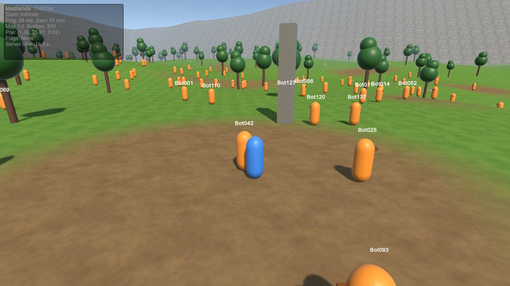
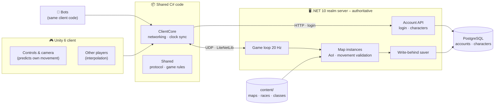

<div align="center">

# ⚔️ Madlands

**A WoW-inspired MMORPG, built from scratch, one playable step at a time.**


[](https://github.com/Mad-Mange/Madlands/actions/workflows/ci.yml)


<sub><i>Phase 1: a real player (blue) and 200 bots (orange) sharing one world, kept in sync by the server.</i></sub>

</div>

> [!NOTE]
> **This is an early-stage, work-in-progress project.** Madlands is a solo project with a big goal: a homemade MMORPG in the spirit of World of Warcraft, with tab-target combat, quests, dungeons and a shared world.
> What you see today is **the engine room**. All art is placeholder (capsules and lollipop trees). Real art arrives in Phase 5.
> Development is AI-assisted (Claude Code).

## What is Madlands?

Three hundred years ago the moon **Ysolde** cracked and rained shards across the continent of **Calderra**. Wherever the shards fell, the land twisted into what people now call *the Madlands*. The shards are also the source of all magic: some want to harvest their power, others want to seal them away forever. <sub>([lore draft](docs/gdd.md))</sub>

**The goal** is a small but real MMO, with the same kinds of systems as WoW and a much smaller world:

- Tab-target combat with cast times, cooldowns and auras
- Classes and races, quests, loot and gear
- Groups, guilds and dungeons
- A stylized low-poly world

**The approach:** the game is built **one playable phase at a time**. The architecture is designed for the finished game from day one, so nothing built early has to be thrown away later.

## 🗺️ Progress

| Phase | Scope | Status |
|:---:|---|:---:|
| 0 | Foundation: repo, tooling, architecture, decision log | ✅ Done |
| 1 | **Walking skeleton:** many players in one world, synced by the server | ✅ Done |
| 2 | **Accounts, login, characters, database** | ✅ Done |
| 3 | Core combat: targeting, spells, auras, NPC AI, XP | 🔜 Next |
| 4 | Items, loot, economy, quests | ⬜ |
| 5 | Vertical slice: the first real zone, with real art. *"Is it fun?"* | ⬜ |
| 6–7 | Social (chat, groups, guilds) and dungeons | ⬜ |
| 8–10 | Bigger world, talents, professions, PvP, launch | ⬜ |

Details: [docs/roadmap.md](docs/roadmap.md)

### Latest milestone: Phase 2 ✅

Players now have **accounts and persistent characters**. You log in, pick or create a character, enter the world, and come back to the same spot after logging out or a server restart.

| What | How |
|---|---|
| Accounts | Register and log in through an HTTP account API; Argon2id password hashes, hashed session tokens |
| Characters | Create, select, delete; up to 10 per account, realm-unique names; races and classes are data |
| Persistence | PostgreSQL with migrations; positions saved write-behind (the game loop never waits for the database) |
| Client | Login, character select and create screens in UI Toolkit; the map scene is loaded by the id the server sends |
| Verified | 100 bots registering and playing at once; a full server restart keeps everyone's position; 72 automated tests |

<details>
<summary>Phase 1 measurements</summary>

| Measurement | Result |
|---|---|
| Concurrent players in the test | 200 bots + 1 real client |
| Server tick (target < 5 ms) | **0.4–0.9 ms** average |
| Movement corrections by the server | **0** during the whole test |
| Local ping | ~15–30 ms |
| Client FPS with 200 visible players | 375–1100 |

</details>

## 📸 Progress gallery

<table>
  <tr>
    <td width="50%"></td>
    <td width="50%"></td>
  </tr>
  <tr>
    <td><sub><b>Phase 2 · Login.</b> Accounts with Argon2id-hashed passwords; the server field allows connecting to any realm.</sub></td>
    <td><sub><b>Phase 2 · Character select.</b> Characters live in PostgreSQL; race and class names come from the server's content files.</sub></td>
  </tr>
  <tr>
    <td width="50%"></td>
    <td width="50%"></td>
  </tr>
  <tr>
    <td><sub><b>Gameplay view.</b> WoW-style third-person camera, nameplates, and the debug overlay (F3) with ping, entity count and position.</sub></td>
    <td><sub><b>The "Testlands" test world.</b> 512 × 512 m of hills, forest and fog, generated entirely from code.</sub></td>
  </tr>
  <tr>
    <td></td>
    <td valign="top">
      <sub><b>Top-down map.</b> The dirt clearing in the middle is the spawn point. The rocky rim keeps players inside. The height map is exported from Unity to the server, which uses it to decide whether a movement is possible.</sub>
      <br><br>
      <b>Dev log</b>
      <ul>
        <li><sub><b>2026-10-16 – Phase 2 done.</b> Accounts, persistent characters, PostgreSQL, login and character screens, CI. Characters survive logout and server restarts.</sub></li>
        <li><sub><b>2026-10-16 – Phases 0 & 1 done.</b> Server, client, bots and tests are in place. 200 players run around without a single movement correction.</sub></li>
      </ul>
    </td>
  </tr>
</table>

## 🏗️ How it works



**Core principles**

- **The server is the authority.** The client moves its own character immediately so it feels responsive. The server checks every move (speed, clock, terrain) and corrects cheating.
- **The engine is replaceable.** All game logic lives in the server and in shared C# code that is not allowed to reference Unity. The client is "just" a view.
- **Content is data.** Maps, and later spells, items and quests, are text files with stable IDs, validated automatically.
- **Bots run the exact same client code as the game.** That makes it possible to load-test with hundreds of "players" on one machine.

More in [docs/architecture.md](docs/architecture.md) and the decision log in [docs/adr/](docs/adr/).

## 🧰 Tech stack

| Part | Choice |
|---|---|
| Client | Unity 6 (URP), Input System, UI Toolkit |
| Server | .NET 10, LiteNetLib (UDP), ASP.NET Core minimal API (account API), Serilog |
| Persistence | PostgreSQL, Npgsql + Dapper, DbUp migrations, Argon2id |
| Shared code | C# (netstandard2.1), compiled by both Unity and .NET |
| Testing | xUnit, headless bot clients, GitHub Actions CI with PostgreSQL |
| Coming up | DotRecast (navmesh), Addressables, Localization |

## 🚀 Getting started

Requirements: [.NET 10 SDK](https://dotnet.microsoft.com/), Unity 6000.6.5f1 and Docker (for PostgreSQL).

```powershell
# 1. Start PostgreSQL (once; it keeps running in Docker)
docker compose -f deploy/docker-compose.yml up -d

# 2. Start the realm server: game on UDP 7777, account API on HTTP 7780 (local only)
dotnet run --project server/Madlands.Server -c Release -- --bind 127.0.0.1
#    No Docker? Add --db memory (accounts and characters are lost when the server stops).

# 3. (optional) bots that register, log in and run around (lift the API rate limit for many bots)
#    server: ... --api-rate-limit 0
dotnet run --project server/Madlands.Bots -c Release -- --count 100

# 4. Client: open client/ in Unity Hub and press Play (it always starts at the login screen),
#    or build an exe via Madlands > Build Windows Client. Create an account on the login screen, or
#    skip the screens in dev: -autoconnect logs in as the lowercased name, creating account and character.
builds/client/Madlands.exe -screen-fullscreen 0 -autoconnect -name Alice
builds/client/Madlands.exe -screen-fullscreen 0 -autoconnect -name Bob
```

Run the tests with `dotnet test Madlands.slnx` (PostgreSQL tests are skipped if the database is not running).

### 🎮 Controls (WoW-style)

| Input | Action |
|---|---|
| W / S | Forward / backward (backpedaling is slower) |
| A / D | Turn (strafe while holding the right mouse button) |
| Q / E | Strafe left / right |
| Right mouse + drag | Steer the character and the camera |
| Left mouse + drag | Orbit the camera freely |
| Both mouse buttons | Run forward |
| Mouse wheel | Zoom |
| Space | Jump (no air control) |
| Num Lock / R | Autorun |
| Esc | Menu (log out to character select, exit) |
| F3 | Toggle the debug overlay |

## 📁 Project structure

```
client/                    Unity 6 project (our code in Assets/Madlands)
shared/Madlands.Shared     Protocol and game rules, shared by server and client
shared/Madlands.ClientCore Engine-free networking & sync, used by the client and bots
server/Madlands.Server     The realm server: game loop, account API, persistence
server/Madlands.Bots       Bot players for load testing
server/Madlands.Content    Loads and validates game data
content/                   Game data (maps, races, classes; later spells, items, quests …)
deploy/                    Docker Compose for PostgreSQL and Seq (logs)
tools/                     Tooling (ContentTool)
docs/                      Architecture, decision log (ADR), roadmap, game design
```

## 📚 Documentation

- [Roadmap & status](docs/roadmap.md)
- [Architecture](docs/architecture.md) and [decision log (ADR)](docs/adr/)
- [Game design & lore (draft)](docs/gdd.md)

## License

No license has been chosen yet, so all rights are reserved for now. Feel free to look around and get inspired.
Madlands is not affiliated with Blizzard Entertainment or World of Warcraft.
