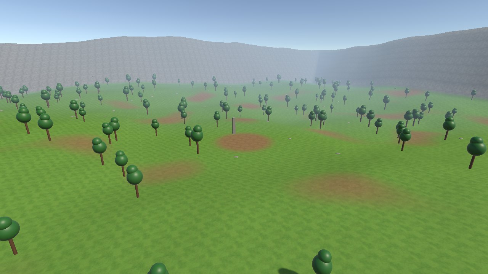
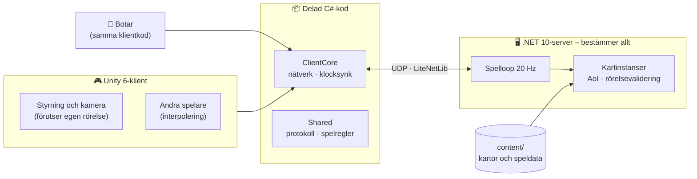

<div align="center">

# ⚔️ Madlands

**En WoW-inspirerad MMORPG som byggs från grunden, bit för bit.**


<sub><i>Fas 1: en riktig spelare (blå) och 200 botar (orange) i samma värld. Servern håller ihop allt.</i></sub>

</div>

> [!NOTE]
> **Ett pågående projekt i ett tidigt skede.** Madlands är ett soloprojekt för att lära sig och bygga något stort: en egen MMORPG i stil med World of Warcraft, med tab-target-strid, quests, dungeons och en delad värld.
> Det du ser i dag är **tekniken under huven**. Grafiken består av platshållare (kapslar och "klubbträd"). Riktig grafik kommer i Fas 5.
> Projektet utvecklas med AI-assistans (Claude Code).

## Vad är Madlands?

För tre hundra år sedan sprack månen **Ysolde** och regnade skärvor över kontinenten **Calderra**. Där skärvorna landade vreds landet till det folk kallar *Vansinneslanden*. Skärvorna är också källan till all magi. Några vill skörda deras kraft, andra vill försegla dem för gott. <sub>([lore-utkast](docs/gdd.md))</sub>

**Målet:** en liten men riktig MMO, med samma typ av system som i WoW men med en mindre värld.

- Tab-target-strid med kasttider, cooldowns och auror
- Klasser och raser, quests, loot och utrustning
- Grupper, guilds och dungeons
- En stiliserad low-poly-värld

**Arbetssättet:** spelet byggs **en spelbar fas i taget**. Från dag ett är det byggt för att kunna växa, så att inget i början behöver kastas när det blir större.

## 🗺️ Progress

| Fas | Innehåll | Status |
|:---:|---|:---:|
| 0 | Grunden: repo, verktyg, arkitektur, beslutslogg | ✅ Klar |
| 1 | **Gående skelett:** många spelare i samma värld, synkade av servern | ✅ Klar |
| 2 | Konton, inloggning, karaktärer, databas | 🔜 Nästa |
| 3 | Kärnstrid: målval, spells, auror, NPC-AI, XP | ⬜ |
| 4 | Föremål, loot, ekonomi, quests | ⬜ |
| 5 | Vertikal skiva: första riktiga zonen, med riktig grafik. *"Är det kul?"* | ⬜ |
| 6–7 | Socialt (chatt, grupper, guilds) och dungeons | ⬜ |
| 8–10 | Större värld, talanger, yrken, PvP, lansering | ⬜ |

Detaljerna finns i [docs/roadmap.md](docs/roadmap.md).

### Senaste milstolpen: Fas 1 ✅

| Mätning | Resultat |
|---|---|
| Samtidiga spelare i testet | 200 botar och 1 riktig klient |
| Servertick (mål < 5 ms) | **0,4–0,9 ms** i snitt |
| Felaktiga rörelser som servern fick rätta | **0** under hela testet |
| Ping lokalt | cirka 15–30 ms |
| Klientens FPS med 200 synliga spelare | 375–1100 |
| Automatiska tester | 46 gröna, bland annat riktig server och klienter över UDP |

## 📸 Bilder från resan

<table>
  <tr>
    <td width="50%"></td>
    <td width="50%"></td>
  </tr>
  <tr>
    <td><sub><b>Spelvyn.</b> Tredjepersonskamera i WoW-stil, namnskyltar och debugpanel (F3) med ping, entiteter och position.</sub></td>
    <td><sub><b>Testvärlden "Testlands".</b> 512 × 512 m med kullar, skog och dimma. Den genereras helt från kod.</sub></td>
  </tr>
  <tr>
    <td></td>
    <td valign="top">
      <sub><b>Kartan ovanifrån.</b> Grusplatsen i mitten är spawn. Klippkanten håller spelarna inne. Höjdkartan exporteras från Unity till servern, så att servern kan avgöra om en rörelse är möjlig.</sub>
      <br><br>
      <b>Utvecklingslogg</b>
      <ul>
        <li><sub><b>2026-10-16: Fas 0 och 1 klara.</b> Server, klient, botar och tester på plats. 200 spelare springer runt utan en enda rättning av rörelserna.</sub></li>
      </ul>
    </td>
  </tr>
</table>

## 🏗️ Så fungerar det



**Grundprinciperna**

- **Servern bestämmer.** Klienten flyttar sin egen gubbe direkt så att det känns snabbt. Servern kontrollerar varje rörelse (hastighet, klocka, terräng) och rättar fusk.
- **Motorn är utbytbar.** All spellogik ligger i servern och i delad C#-kod som inte får använda Unity. Klienten är "bara" en vy.
- **Innehåll är data.** Kartor, och senare spells, föremål och quests, lagras som textfiler med stabila id:n och valideras automatiskt.
- **Botar använder exakt samma klientkod som spelet.** Därför går det att lasttesta med hundratals "spelare" på en vanlig dator.

Mer finns i [docs/architecture.md](docs/architecture.md) och beslutsloggen i [docs/adr/](docs/adr/).

## 🧰 Teknik

| Del | Val |
|---|---|
| Klient | Unity 6 (URP), Input System |
| Server | .NET 10, LiteNetLib (UDP), Serilog |
| Delad kod | C# (netstandard2.1), kompileras både av Unity och .NET |
| Test | xUnit, headless bot-klienter |
| Kommer | PostgreSQL, UI Toolkit, Addressables, DotRecast (navmesh) |

## 🚀 Kom igång

Krav: [.NET 10 SDK](https://dotnet.microsoft.com/) och Unity 6000.6.5f1. Docker behövs först i Fas 2.

```powershell
# 1. Starta servern (lyssnar på UDP 7777, bara lokalt)
dotnet run --project server/Madlands.Server -c Release -- --bind 127.0.0.1

# 2. (valfritt) 200 botar som springer runt
dotnet run --project server/Madlands.Bots -c Release -- --count 200

# 3. Klienten: öppna client/ i Unity Hub, öppna scenen Assets/Madlands/Scenes/World_0001 och tryck Play.
#    Eller bygg en exe via menyn Madlands > Build Windows Client och starta två fönster:
builds/client/Madlands.exe -screen-fullscreen 0 -autoconnect -name Alice
builds/client/Madlands.exe -screen-fullscreen 0 -autoconnect -name Bob
```

Testerna kör du med `dotnet test Madlands.slnx`.

### 🎮 Styrning (som i WoW)

| Tangent | Funktion |
|---|---|
| W / S | Framåt / bakåt (bakåt är långsammare) |
| A / D | Sväng (strafe när höger musknapp hålls nere) |
| Q / E | Strafe vänster / höger |
| Höger mus + dra | Styr gubben och kameran |
| Vänster mus + dra | Rotera kameran fritt runt gubben |
| Båda musknapparna | Spring framåt |
| Mushjul | Zooma |
| Mellanslag | Hoppa (ingen styrning i luften) |
| Num Lock / R | Autorun |
| F3 | Visa/dölj debugpanelen |

## 📁 Projektstruktur

```
client/                   Unity 6-projektet (vår kod i Assets/Madlands)
shared/Madlands.Shared    Protokoll och spelregler, delas av server och klient
shared/Madlands.ClientCore Nätverk och synk utan Unity, används av klient och botar
server/Madlands.Server    Spelservern
server/Madlands.Bots      Bot-spelare för lasttester
server/Madlands.Content   Laddar och validerar speldata
content/                  Speldata (kartor, senare spells, items, quests …)
tools/                    Verktyg (ContentTool)
docs/                     Arkitektur, beslutslogg (ADR), roadmap, speldesign
```

## 📚 Dokumentation

- [Roadmap och status](docs/roadmap.md)
- [Arkitektur](docs/architecture.md) och [beslutslogg (ADR)](docs/adr/)
- [Speldesign och lore (utkast)](docs/gdd.md)

## Licens

Ingen licens är vald ännu. Tills vidare gäller alla rättigheter förbehållna. Titta och inspireras gärna.
Madlands är inte kopplat till Blizzard Entertainment eller World of Warcraft.
