<div align="center">

# ⚔️ Madlands

**A WoW-inspired MMORPG, built from scratch, one playable step at a time.**


[](https://github.com/Mad-Mange/Madlands/actions/workflows/ci.yml)


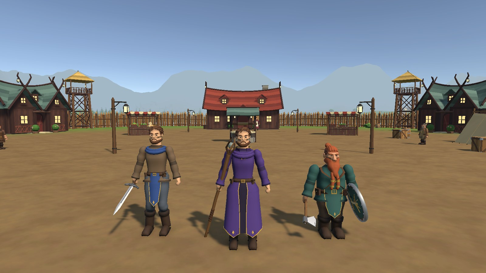

<sub><i>Phase 5: adventurers on the square of Mirewatch, the village of Hollowmere: a human warrior in a blue tabard and cowl, a shardmage in a long violet coat and a Korrin warden in a leather jerkin with a fur collar. The models, animations and the village itself are made by scripts in Blender and Unity.</i></sub>

</div>

> [!NOTE]
> **This is an early-stage, work-in-progress project.** Madlands is a solo project with a big goal: a homemade MMORPG in the spirit of World of Warcraft, with tab-target combat, quests, dungeons and a shared world.
> What you see today is **a first playable zone in deliberately simple low-poly art**: models, animations, music and sounds are made by scripts (Blender and a small synthesizer) so they can be refined later. Item and spell icons are still colored tiles.
> Development is AI-assisted (Claude Code).

## What is Madlands?

Three hundred years ago the moon **Ysolde** cracked and rained shards across the continent of **Calderra**. Wherever the shards fell, the land twisted into what people now call *the Madlands*. The shards are also the source of all magic: some want to harvest their power, others want to seal them away forever. <sub>([lore draft](docs/gdd.md))</sub>

**The goal** is a small but real MMO, with the same kinds of systems as WoW and a much smaller world:

- Tab-target combat with cast times, cooldowns and auras
- Classes and races, quests, loot and gear
- Groups, guilds and dungeons
- A stylized low-poly world

**The approach:** the game is built **one playable phase at a time**. The architecture is designed for the finished game from day one, so nothing built early has to be thrown away later.

## 🗺️ Progress

| Phase | Scope | Status |
|:---:|---|:---:|
| 0 | Foundation: repo, tooling, architecture, decision log | ✅ Done |
| 1 | **Walking skeleton:** many players in one world, synced by the server | ✅ Done |
| 2 | **Accounts, login, characters, database** | ✅ Done |
| 3 | **Core combat:** targeting, spells, auras, creature AI, XP and levels | ✅ Done |
| 4 | **Items, loot, economy, quests** | ✅ Done |
| 5 | Vertical slice: the first real zone, with real art. *"Is it fun?"* | 🚧 Playtests left |
| 6–7 | Social (chat, groups, guilds) and dungeons | ⬜ |
| 8–10 | Bigger world, talents, professions, PvP, launch | ⬜ |

Details: [docs/roadmap.md](docs/roadmap.md)

### In progress: Phase 5, the vertical slice 🚧

Everything for the first real zone is in; what is left is putting a realm online and playtesting it with friends.

| What | How |
|---|---|
| Hollowmere | A 1 km valley around a shallow mere, generated by code: the village of Mirewatch, Westbrook's farms, the Reedfen marsh, the Greywood, the Shardscar quarry and the Drowned Ruins ([zone guide](docs/zones/hollowmere.md)) |
| Content | 30 quests in six chains, 15 creature types, 10 NPCs and two bosses: Gloomjaw in its lagoon, and Ruukhar the Slagborn in the Cinder Cut with a slam to run from, a stacking burn and an enrage. Glowcap mushrooms to gather in the Greywood; area names on the minimap |
| Art | Low-poly models made by Python scripts in Blender: two races and the fish-folk mirelings, creatures and bosses, weapons, 40 props and the spell effects, from Mirewatch's gates, palisade and timber grove houses to half-timbered cottages, the Muddy Boot inn, layered pines and leafy oaks ([ADR 0012](docs/adr/0012-art-pipeline-blender.md)). The races are stylized after classic fantasy MMOs and sculpted like clay (shapes blended into each other, shaded smoothly): square jaws and heavy brows, eyes with lids, thick swept hair, the Korrin's great braided beard and topknot, muscled arms that bend at the elbow, chunky fists and boots. Body, hair, beard and every gear piece are meshes of their own, each in three levels of detail |
| Gear | Worn armor is modeled: helmets, hoods and hats, shoulder pads and mantles, cloaks that trail behind a runner, robes whose skirts follow the legs, breastplates with tassets and gilded rims, gauntlets, greaves, sashes and aprons, and the classes' looks: tabards, a cowl with its hood thrown back, the shardmage's long coat with split tails and a glowing crystal, the warden's laced leather jerkin with a fur collar and belt flaps, a cloak with the Greywood's tree. Built into every race's model from its own proportions; the NPCs wear them too |
| Animation | 16 humanoid clips made once and retargeted to every race; creatures have their own |
| Sound | Synthesized music and ambience per area, footsteps that splash in the water, swings, hits, spells by school, jingles; effects from Kenney's CC0 packs ([credits](CREDITS.md)) |
| Getting around | Sprint on stamina (Shift); the world map and minimap circle where each quest objective is done, worked out from where the creatures live (labeled with the quest's level, colored by how hard it is for you), and a gold "?" shows where to turn in a finished quest (on the minimap's rim when it is far away); lootable corpses shimmer; symbols over vendors and the innkeeper; bigger click targets and clickable nameplates |
| Rested experience | Rest in Mirewatch or log out there and kills give double experience for a while, as in WoW: a darker stretch on the blue experience bar shows how much is left |
| Interface | Two action bars you arrange yourself (Shift-drag), with potions, food and elixirs on them too, and a spellbook (P); gear tooltips compare with what you wear; 30-minute buffs and elixirs that last through logging out; levels on the character select screen |
| Settings | Rebindable keys, mouse, graphics, window mode and resolution, interface scale, volumes; every interface text in a string table ([ADR 0013](docs/adr/0013-localization.md)) |
| Online | A deployment guide for a VPS behind Caddy (TLS) ([deployment.md](docs/deployment.md)) |

<table>
  <tr>
    <td width="50%">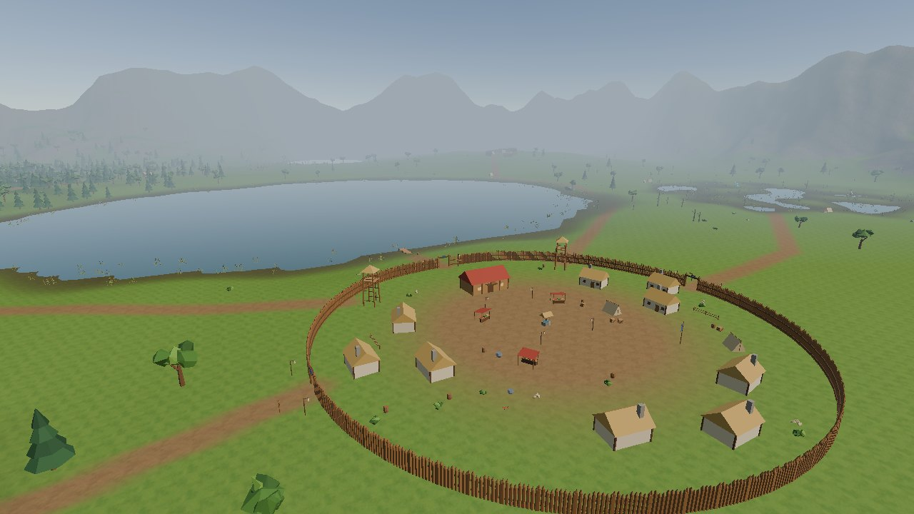</td>
    <td width="50%">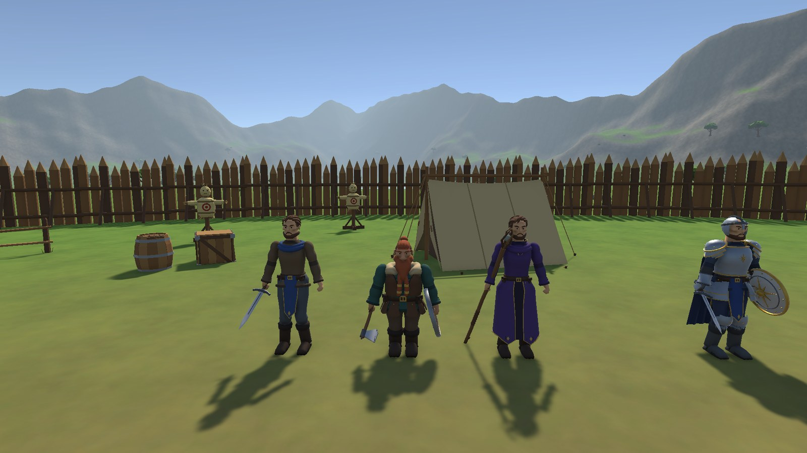</td>
  </tr>
  <tr>
    <td><sub><b>Mirewatch.</b> The village inside its palisade on the shore of the mere, the Reedfen marsh and the Greywood beyond.</sub></td>
    <td><sub><b>The heroes.</b> New characters start in their class's look: the warrior's blue tabard and cowl, the warden's leather jerkin with a fur collar and belt flaps over a teal shirt, the shardmage's long violet coat. Captain Brand wears the full knight's plate and the star shield. Sculpted faces, hair and beards, shaded smoothly, in three levels of detail.</sub></td>
  </tr>
  <tr>
    <td>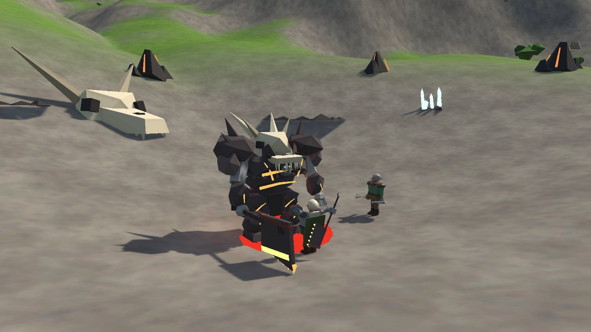</td>
    <td>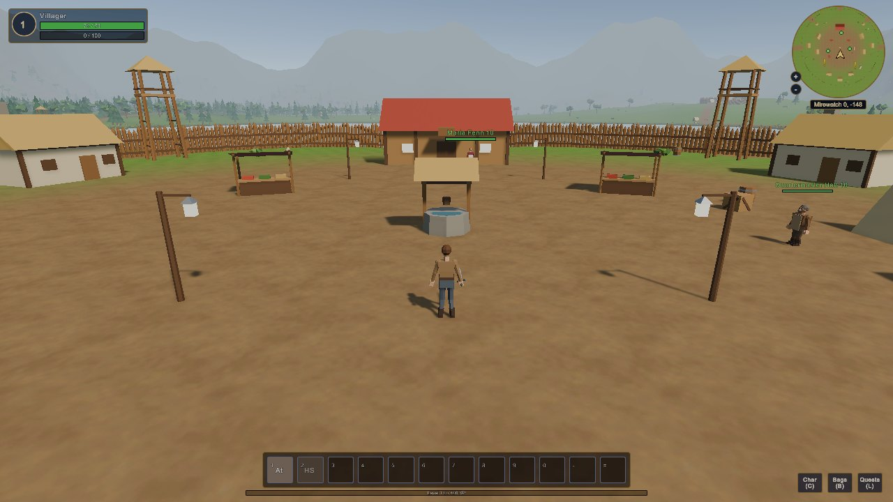</td>
  </tr>
  <tr>
    <td><sub><b>Ruukhar the Slagborn.</b> A warden and a warrior (in the skull hood Ruukhar drops) take on the brute of the Cinder Cut. His Cinder Quake runs out as a wave of fire and embers: get out of reach while he winds up.</sub></td>
    <td><sub><b>The square of Mirewatch.</b> Timber grove houses around the well and the inn. Symbols and titles show what the NPCs do (Gerta the weaponsmith, Holt's general goods); the minimap marks the quests.</sub></td>
  </tr>
  <tr>
    <td>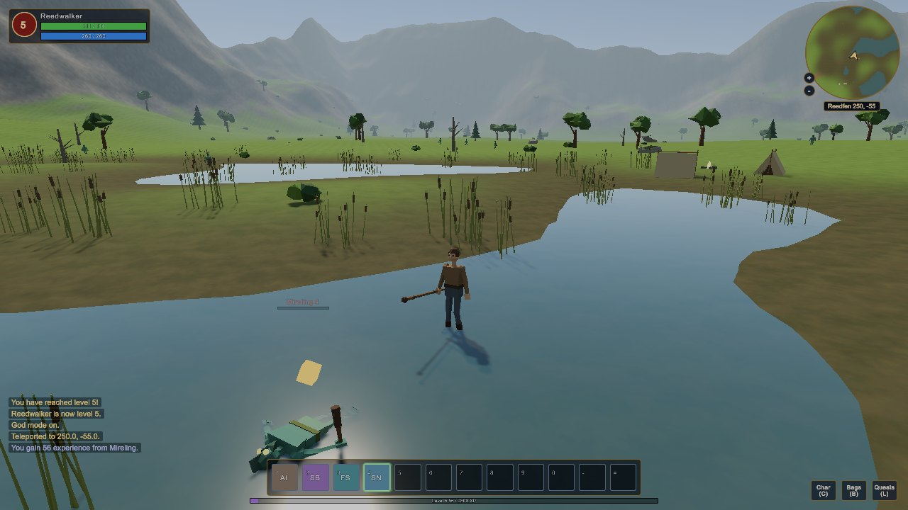</td>
    <td>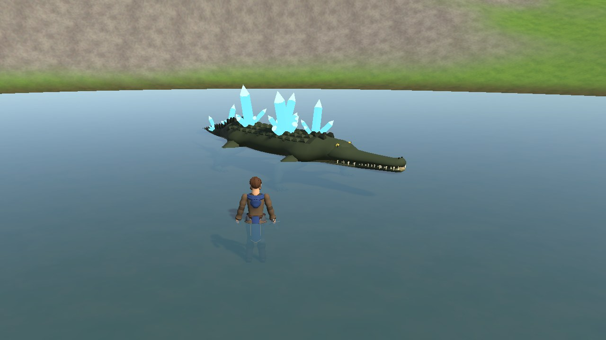</td>
  </tr>
  <tr>
    <td><sub><b>Reedfen.</b> Wading through the marsh; the mirelings' huts in the reeds.</sub></td>
    <td><sub><b>Gloomjaw's lagoon.</b> Shardlings guard the world boss, a crocodile grown over with moon shards.</sub></td>
  </tr>
  <tr>
    <td>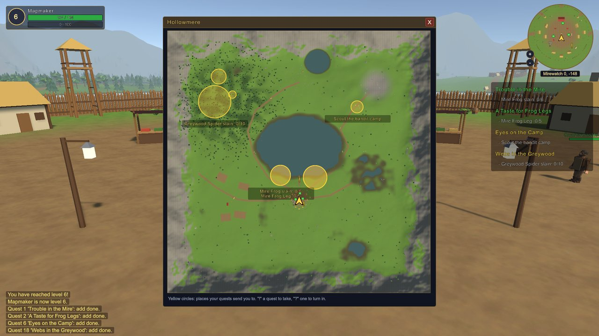</td>
    <td>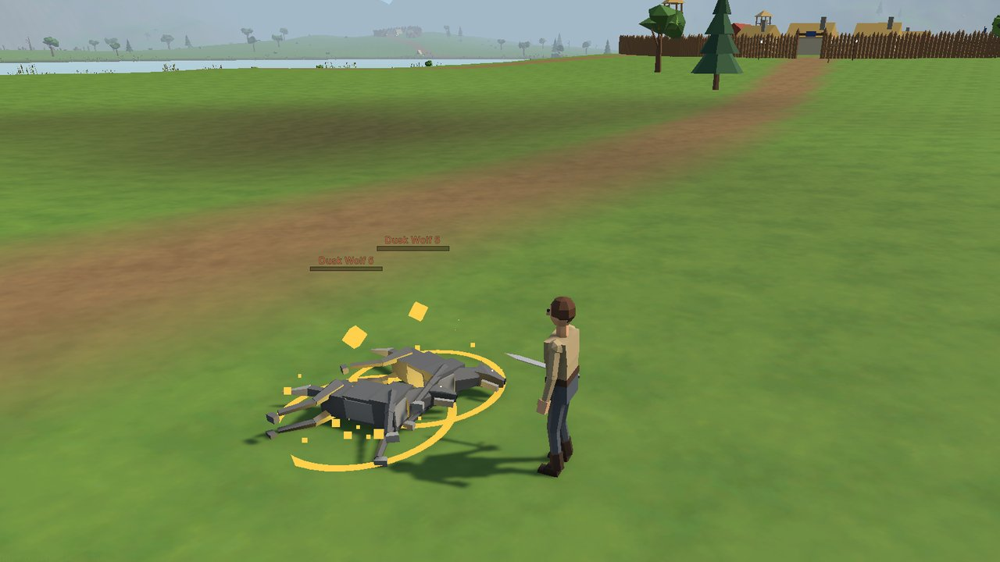</td>
  </tr>
  <tr>
    <td><sub><b>Where to go.</b> The world map circles where every active objective is done: the frogs on the south shore (two quests share the circles), the spiders in the Greywood, the bandit camp to scout.</sub></td>
    <td><sub><b>Loot.</b> Corpses you can loot get a golden halo, little stars rising, a cut gem turning above them and a soft glow.</sub></td>
  </tr>
  <tr>
    <td>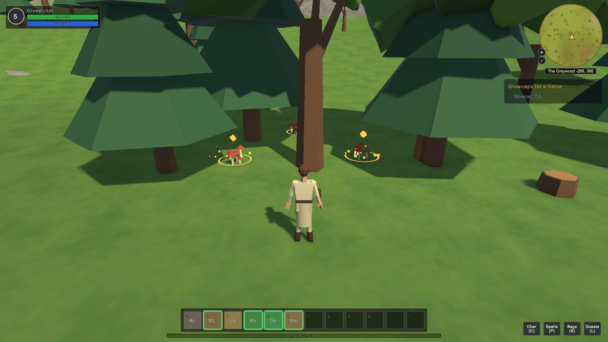</td>
    <td>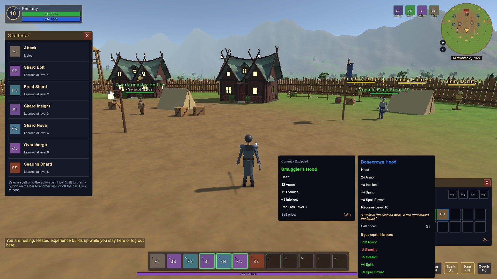</td>
  </tr>
  <tr>
    <td><sub><b>Glowcaps.</b> Mushrooms at the feet of the Greywood's trees shine while Old Tamsin's quest needs them; right-click to pick them. They grow back.</sub></td>
    <td><sub><b>Spellbook and tooltips.</b> Drag spells onto the action bar from the spellbook (P). A gear tooltip shows what equipping it changes; long buffs last 30 minutes.</sub></td>
  </tr>
  <tr>
    <td>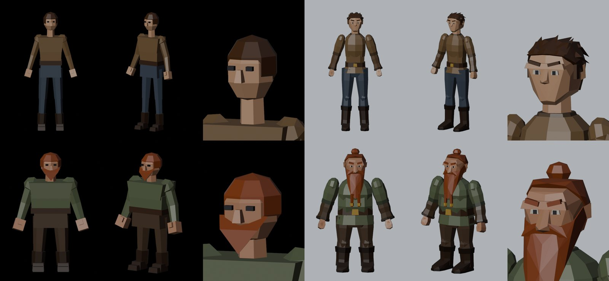</td>
    <td>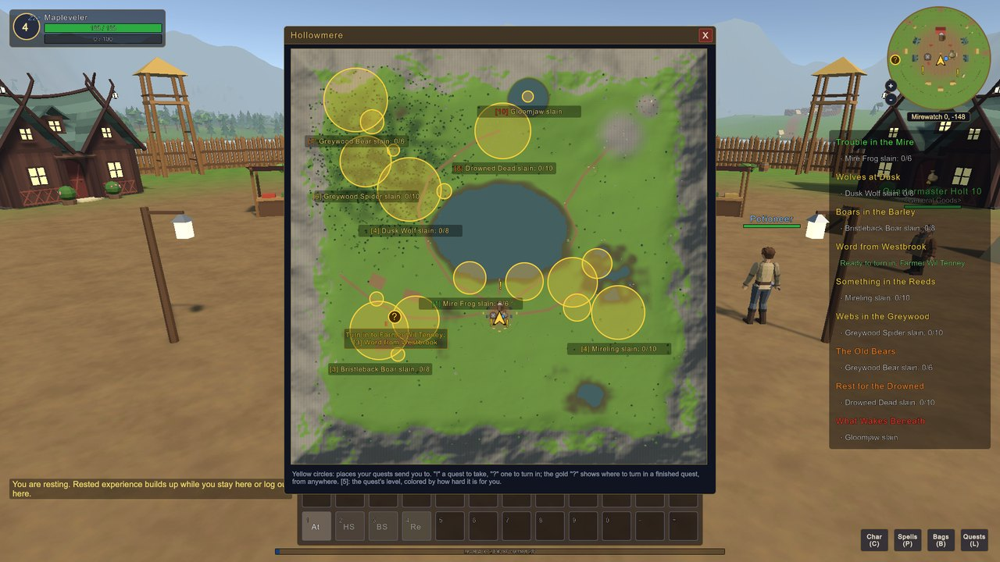</td>
  </tr>
  <tr>
    <td><sub><b>Remodeled characters.</b> Before (left) and after, made by the same Blender scripts: heroic proportions, faces with brows and eyes, swept hair, the Korrin's braided beard and topknot, belts with buckles and cuffed boots.</sub></td>
    <td><sub><b>Quest levels on the map.</b> Every circle's label starts with the quest's level, colored by how hard it is for you (gray, green, yellow, orange, red). A gold "?" marks where a finished quest is turned in.</sub></td>
  </tr>
  <tr>
    <td>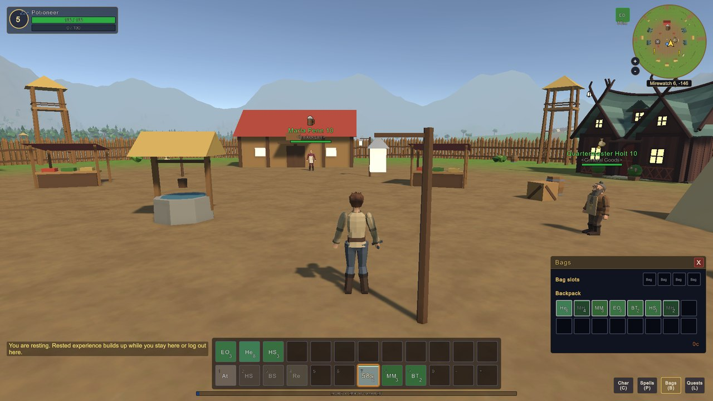</td>
    <td>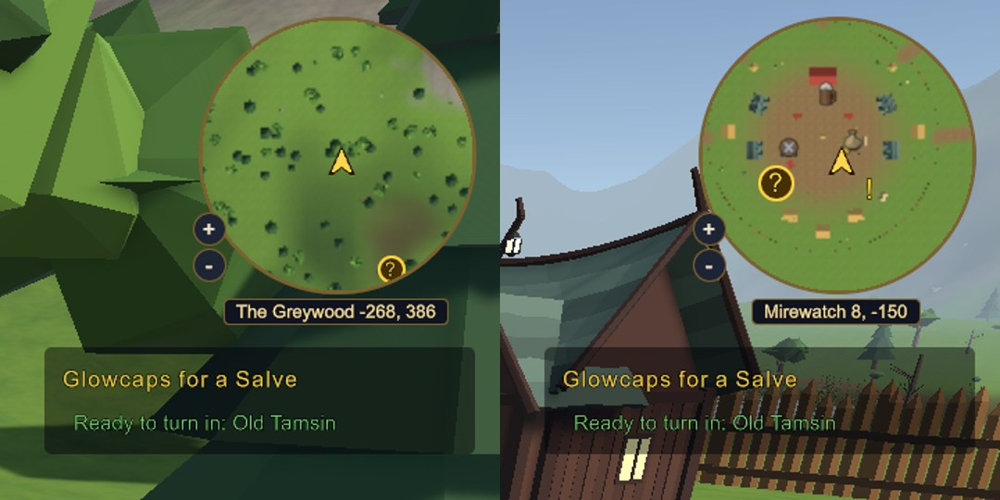</td>
  </tr>
  <tr>
    <td><sub><b>Two action bars.</b> Potions, food, tonics and elixirs go on them from the bags: each button shows how many are left and its cooldown (the healing draught), and the elixir's buff lasts 30 minutes.</sub></td>
    <td><sub><b>Turn in, from anywhere.</b> Far away, the gold "?" waits on the minimap's rim, pointing toward the quest's ender (left); close by, it marks the NPC (right).</sub></td>
  </tr>
  <tr>
    <td>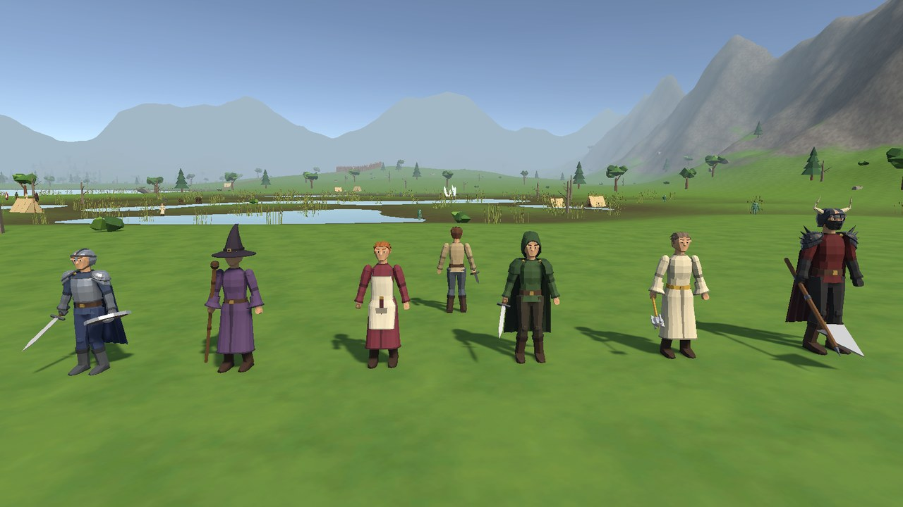</td>
    <td>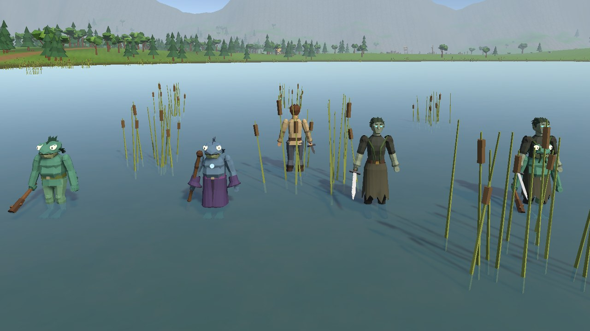</td>
  </tr>
  <tr>
    <td><sub><b>Modeled gear.</b> Captain Brand's helm, pauldrons, gilded breastplate, tabard, cloak and star shield, Tamsin's pointed hat, Marla's apron, Rennick's hood and cloak, Brother Aldous's robe and Vorn's horned helm: every piece is built into each race's model and moves with it.</sub></td>
    <td><sub><b>The Reedfen's folk.</b> Mirelings have a model of their own (fish heads, glowing eyes, fins, webbed feet); the oracle wears a robe. The drowned dead wear rags and weed.</sub></td>
  </tr>
  <tr>
    <td>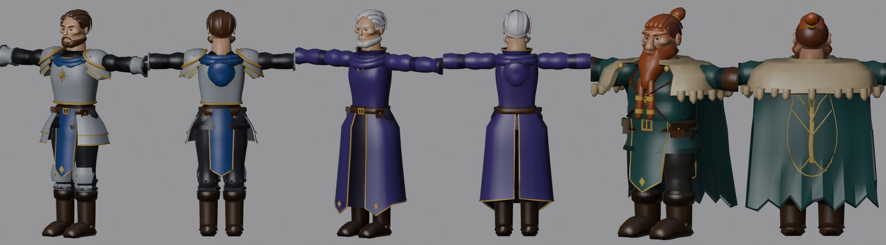</td>
    <td>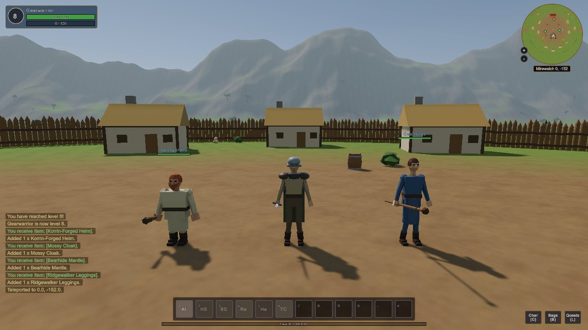</td>
  </tr>
  <tr>
    <td><sub><b>The lookbook.</b> <code>art/blender/lookbook.py</code> renders the races in outfits (front, side, back, poses, faces) to compare them with their reference sheets without Unity: the knight, the shardmage's coat, the warden's fur mantle and cloak with the Greywood's tree.</sub></td>
    <td><sub><b>Gear.</b> A Korrin in the Bonecrown hood, a robe and a sash, a warrior with helm, fur mantle, breastplate, greaves and cloak, a shardmage in the violet coat with pauldrons: worn armor shows on the character, modeled for each race.</sub></td>
  </tr>
  <tr>
    <td>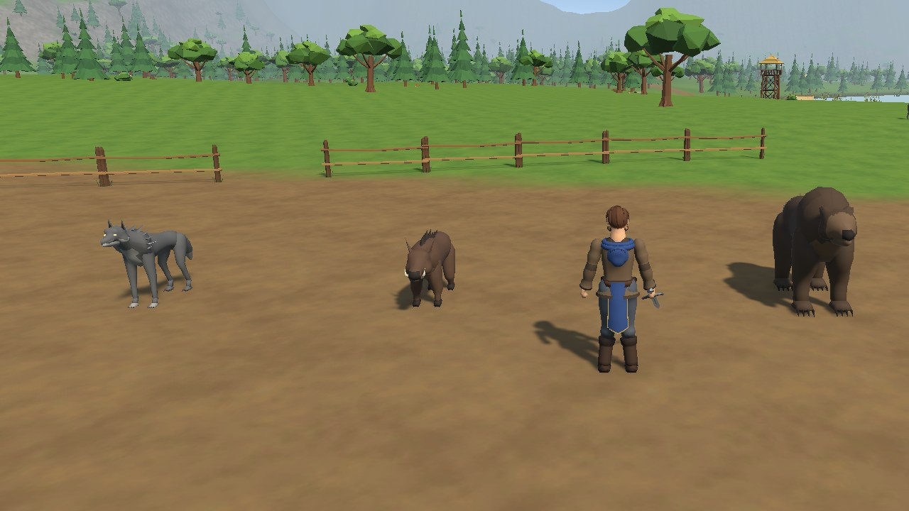</td>
    <td>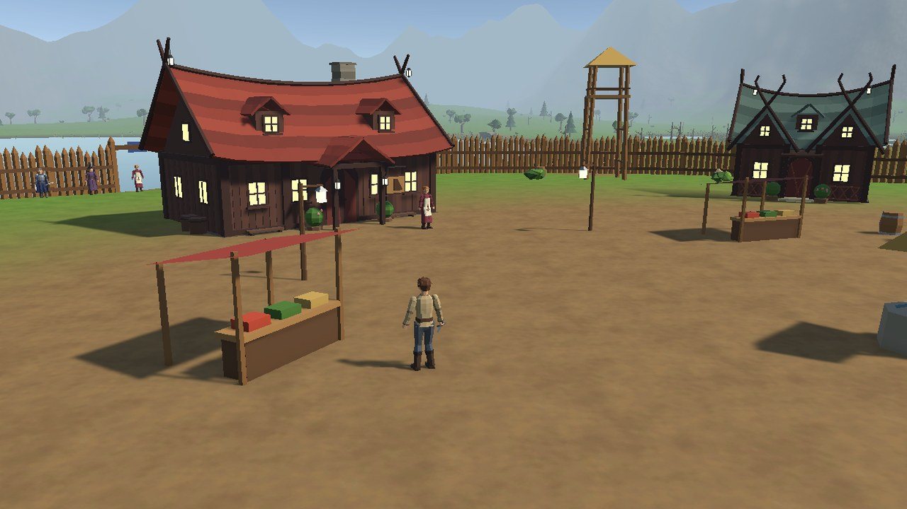</td>
  </tr>
  <tr>
    <td><sub><b>Beasts.</b> The wolf, the boar and the bear are sculpted like the heroes: bodies blended from masses of muscle, legs that grow out of the shoulder and haunch and bend at the joints, muzzles, ears and jaws, padded paws with claws, split hooves, a ruff and a bristly crest.</sub></td>
    <td><sub><b>The Muddy Boot.</b> The inn on Mirewatch's square: red shingles, dormers, lanterns on its horned gables, a porch and a sign with a boot. The cottages are half-timbered under thatch.</sub></td>
  </tr>
  <tr>
    <td>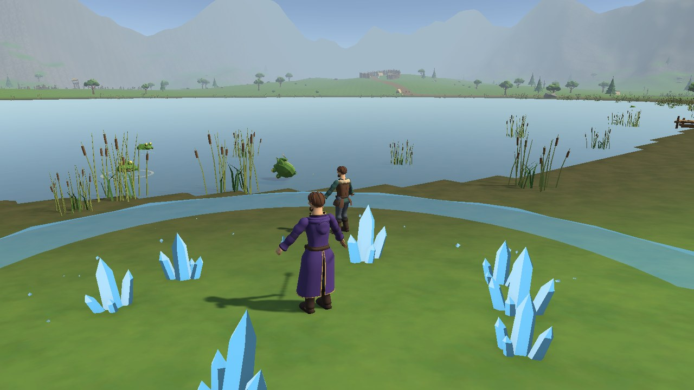</td>
    <td>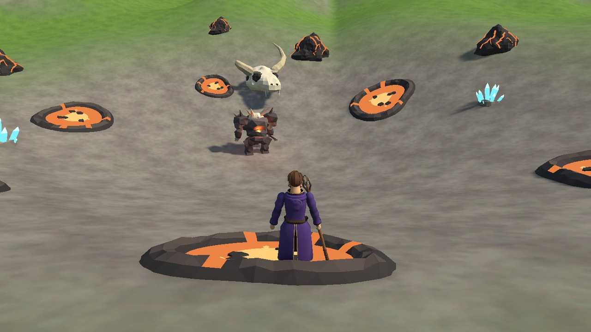</td>
  </tr>
  <tr>
    <td><sub><b>Spells.</b> Spells are modeled too: a turning crystal, star, flame or leaf flies to the target with a trail and bursts in flecks and a flash; casters hold a growing bolt between their hands; Shard Nova raises ice crystals from the ground.</sub></td>
    <td><sub><b>The Cinder Cut.</b> Ruukhar's lair: slag pools with crusted rims, heaps of slag with glowing veins, shard crystals breaking out of the rock and the skull of something enormous.</sub></td>
  </tr>
  <tr>
    <td>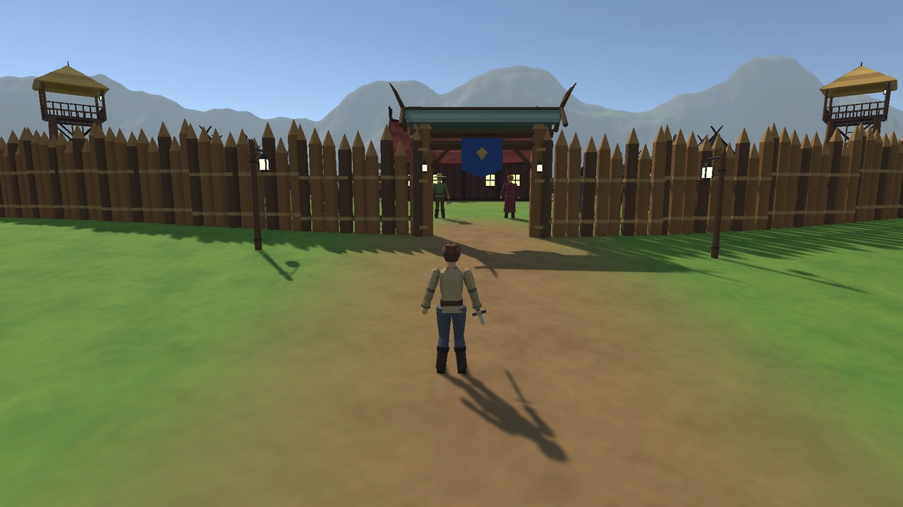</td>
    <td>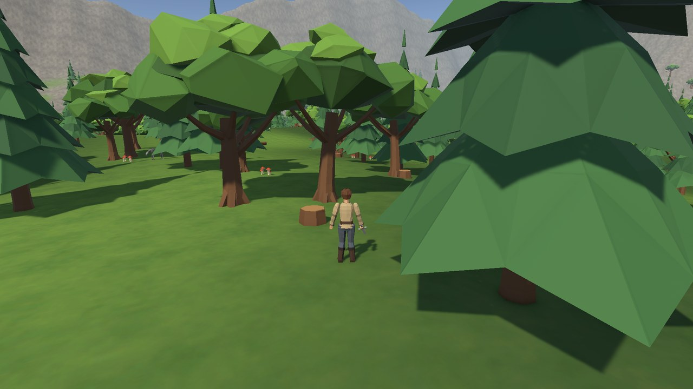</td>
  </tr>
  <tr>
    <td><sub><b>Mirewatch's gate.</b> Towers of bound logs under a horned roof, the village banner, lanterns; the palisade's stakes are lashed to rails, the watchtowers have railings and thatched roofs.</sub></td>
    <td><sub><b>The Greywood.</b> Oaks with crowns in layers of light and shade, tiered pines, stumps, and the glowcaps Old Tamsin wants at the feet of the trees.</sub></td>
  </tr>
</table>

### Latest milestone: Phase 4 ✅

The **core loop** is in: take a quest, go out and fight, loot, get better gear, turn in, level up. The Mirewatch Post next to the spawn has a captain and an old herbalist with eight quests between them, and a quartermaster who buys and sells.

| What | How |
|---|---|
| Items | 45 items as data: weapons, armor, rings and trinkets, bags, food, drink, draughts, quest items and junk, in five qualities ([ADR 0010](docs/adr/0010-items-inventory-loot.md)) |
| Inventory | 20 equipment slots, a backpack and four bag slots. Gear raises your stats and sets your weapon swing; weapons and shields show in your hands |
| Loot | Loot tables per creature, rolled for whoever tapped it. Corpses sparkle for their owner; quest items only drop while you need them; a 3% chance of a green |
| Economy | Gold, silver and copper; a vendor who sells supplies and buys your junk; sell all junk with one click |
| Quests | 8 quests in a chain: kill, collect, talk and explore objectives, reward choices, "!" and "?" over NPCs, quest log (L) and tracker ([ADR 0011](docs/adr/0011-quests-and-npc-dialogs.md)) |
| UI | Bags (B), character sheet (C), item tooltips, loot, vendor and quest windows, drag and drop |
| Verified | 132 automated tests, including loot, vendors, all four quest objectives and relogging on a real server; 200 bots fighting and looting at 0.9–1.5 ms per tick |

<details>
<summary>Phase 3: core combat</summary>

| What | How |
|---|---|
| Classes | **Warrior** (rage, melee), **Shardmage** (mana, ranged, slows and roots), **Warden** (mana, heals and shields); 5–6 abilities each, learned from level 1 to 8 |
| Spells & auras | 19 spells as data: cast times, cooldowns, projectiles, area effects, damage and heals over time, slows, roots, stuns, absorbs, buffs ([ADR 0005](docs/adr/0005-spell-and-aura-model.md)) |
| Creatures | Frogs, a wolf pack, a walled bandit camp with casters, and training dummies. AI with aggro, threat, call for help, pathfinding (DotRecast navmesh) and evading |
| Rules | Server-side hit tables (miss, dodge, parry, crit), armor, line of sight, facing, range; levels 1–10 with classic experience rules |
| HUD | Unit frames, buffs and debuffs, cast bars, an action bar with cooldowns, nameplates, floating combat text, chat, tooltips |
| Tools | GM commands (`.level`, `.tele`, `.spawn`, `.god`, `.info` …); bots that hunt creatures for load tests |
| Verified | 200 bots hunting creatures at 0.8–1.1 ms per server tick, 0 movement corrections; 98 automated tests, including whole fights on a real server |

</details>

<details>
<summary>Phase 2: accounts and characters</summary>

| What | How |
|---|---|
| Accounts | Register and log in through an HTTP account API; Argon2id password hashes, hashed session tokens |
| Characters | Create, select, delete; up to 10 per account, realm-unique names; races and classes are data |
| Persistence | PostgreSQL with migrations; state saved write-behind (the game loop never waits for the database) |
| Client | Login, character select and create screens in UI Toolkit; the map scene is loaded by the id the server sends |

</details>

<details>
<summary>Phase 1 measurements</summary>

| Measurement | Result |
|---|---|
| Concurrent players in the test | 200 bots + 1 real client |
| Server tick (target < 5 ms) | **0.4–0.9 ms** average |
| Movement corrections by the server | **0** during the whole test |
| Local ping | ~15–30 ms |
| Client FPS with 200 visible players | 375–1100 |

</details>

## 📸 Progress gallery

<table>
  <tr>
    <td width="50%"></td>
    <td width="50%"></td>
  </tr>
  <tr>
    <td><sub><b>Phase 4 · Gear.</b> A level 6 Warrior in quest and drop rewards: the two-handed Palisade Breaker in hand, green armor on the character sheet, the old sword and tunic in the bags.</sub></td>
    <td><sub><b>Phase 4 · Loot.</b> Frogs drop copper, junk and, for players on the frog leg quest, frog legs. The tracker on the right counts the kills.</sub></td>
  </tr>
  <tr>
    <td width="50%"></td>
    <td width="50%"></td>
  </tr>
  <tr>
    <td><sub><b>Phase 4 · The quartermaster.</b> Food, water, draughts, a bag and basic gear. Right-click items in your bags to sell them; tooltips show stats, requirements and prices.</sub></td>
    <td><sub><b>Phase 4 · Quest log.</b> Objectives, the story and the rewards; on the left, turning in a finished quest and picking one of three rewards.</sub></td>
  </tr>
  <tr>
    <td width="50%"></td>
    <td width="50%"></td>
  </tr>
  <tr>
    <td><sub><b>Phase 4 · Mirewatch Post.</b> The outpost at the spawn: Old Tamsin's hut, the captain's banner and the supply tent. A yellow "!" means a quest to take, a gray "?" one in progress.</sub></td>
    <td><sub><b>Phase 3 · The HUD.</b> A level 8 Warrior at the training dummies: Rend and Hamstring on the target, rage bar, damage numbers and the action bar with all six warrior abilities.</sub></td>
  </tr>
  <tr>
    <td width="50%"></td>
    <td width="50%"></td>
  </tr>
  <tr>
    <td><sub><b>Phase 3 · Combat.</b> A Shardmage fights the Dusk Wolf pack. The server decides every hit; the client draws the cast bar, debuffs, nameplates and damage numbers.</sub></td>
    <td><sub><b>Phase 3 · The bandit camp.</b> Palisade, tents and crates are exported from Unity as collision geometry. The server builds its navmesh from it, so bandits path around walls, and spells need line of sight.</sub></td>
  </tr>
  <tr>
    <td width="50%"></td>
    <td width="50%"></td>
  </tr>
  <tr>
    <td><sub><b>Phase 2 · Login.</b> Accounts with Argon2id-hashed passwords; the server field allows connecting to any realm.</sub></td>
    <td><sub><b>Phase 2 · Character select.</b> Characters live in PostgreSQL; race and class names come from the server's content files.</sub></td>
  </tr>
  <tr>
    <td width="50%"></td>
    <td width="50%"></td>
  </tr>
  <tr>
    <td><sub><b>Phase 1 · 200 bots.</b> A real player (blue) and 200 bots (orange) sharing one world, kept in sync by the server.</sub></td>
    <td><sub><b>The "Testlands" test world.</b> 512 × 512 m of hills, forest and fog, generated entirely from code.</sub></td>
  </tr>
  <tr>
    <td></td>
    <td valign="top">
      <b>Dev log</b>
      <ul>
        <li><sub><b>2026-10-28 – Beasts and spells.</b> The wolf, the boar and the bear sculpted like the heroes; the shardling of chipped rock; Ruukhar with a sculpted skull hood and the cleaver he drops; the Cinder Cut's slag pools, slag heaps, crystals and giant skull remodeled. Spell effects are models now: crystals, stars, flames and leaves that fly, burst and leave trails, a frost nova that raises ice from the ground, a growing bolt in the caster's hands, a target ring with arrowheads.</sub></li>
        <li><sub><b>2026-10-27 – The heroes.</b> Characters remodeled after reference sheets for the three classes: heads, hair and beards sculpted like clay and shaded smoothly, limbs that bend at the joints, body, hair, beard and gear as separate meshes in three levels of detail. New characters start in their class's look (the warrior's tabard and cowl, the shardmage's long coat, the warden's leather jerkin with a fur collar); new tabards, a jerkin, a coat, a tree cloak, a knight's star shield and a warden's shield; a lookbook renders outfits in Blender.</sub></li>
        <li><sub><b>2026-10-21 – Modeled gear.</b> Helmets, hoods, hats, pads, cloaks, robes, breastplates, gauntlets and greaves are now modeled pieces built into every race's model; the NPCs wear them. Mirelings got their own model; the frog, wolf, boar, bear, spider and shardling were remodeled; Mirewatch got new gates, an inn, cottages, a well, stalls and watchtowers; new trees, rocks and clutter all over the valley; detailed weapons; weapons rest pointing down, staffs stand upright, shields sit on the forearm.</sub></li>
        <li><sub><b>2026-10-20 – Characters and maps.</b> Both races remodeled in Blender after classic fantasy MMOs; finished quests show where to turn them in, from anywhere on the maps; quest levels on the world map; two action bars that hold potions and elixirs too.</sub></li>
        <li><sub><b>2026-10-19 – Phase 5: Hollowmere.</b> The first real zone, generated by code, with low-poly art from Blender scripts, synthesized music, 30 quests and two bosses. Then the polish: sprint, rested experience, quest areas on the maps, NPC symbols, item comparison, a spellbook and an action bar you arrange.</sub></li>
        <li><sub><b>2026-10-18 – Phase 4 done.</b> Items, inventory, loot, vendors and money; data-driven quests with NPC dialogs, a quest log and a tracker; the Mirewatch Post with eight quests. Bots loot too.</sub></li>
        <li><sub><b>2026-10-16 – Phase 3 done.</b> Combat: three classes, spells and auras as data, creature AI with navmesh pathfinding, experience and levels, a full HUD. Bots fight too.</sub></li>
        <li><sub><b>2026-10-16 – Phase 2 done.</b> Accounts, persistent characters, PostgreSQL, login and character screens, CI. Characters survive logout and server restarts.</sub></li>
        <li><sub><b>2026-10-16 – Phases 0 & 1 done.</b> Server, client, bots and tests are in place. 200 players run around without a single movement correction.</sub></li>
      </ul>
    </td>
  </tr>
</table>

## 🏗️ How it works

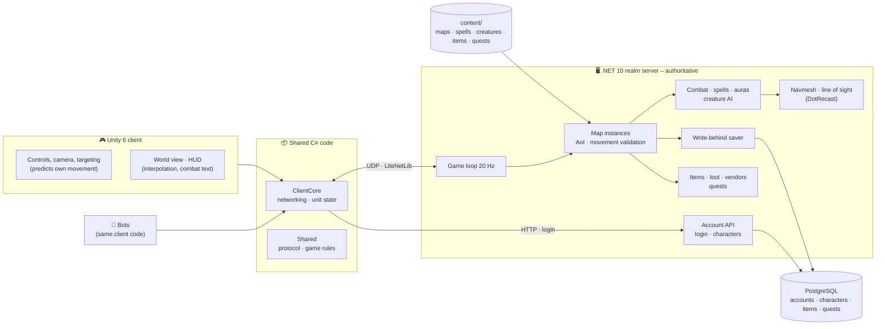

**Core principles**

- **The server is the authority.** The client moves its own character immediately so it feels responsive. The server checks every move and decides every hit, miss and heal.
- **The engine is replaceable.** All game logic lives in the server and in shared C# code that is not allowed to reference Unity. The client is "just" a view.
- **Content is data.** Maps, races, classes, spells, creatures, items, loot tables, quests and spawns are text files with stable IDs, validated automatically. The server sends the client what it needs to show them, so a new spell, item or quest needs no client rebuild.
- **Bots run the exact same client code as the game.** That makes it possible to load-test with hundreds of "players" on one machine.

More in [docs/architecture.md](docs/architecture.md) and the decision log in [docs/adr/](docs/adr/).

## 🧰 Tech stack

| Part | Choice |
|---|---|
| Client | Unity 6 (URP), Input System, UI Toolkit, our own string tables for localization |
| Art & audio | Blender 5 driven by Python scripts (models, animations, interface symbols), a small synthesizer for music and sounds, CC0 effects from Kenney |
| Server | .NET 10, LiteNetLib (UDP), ASP.NET Core minimal API (account API), Serilog, DotRecast (navmesh) |
| Persistence | PostgreSQL, Npgsql + Dapper, DbUp migrations, Argon2id |
| Shared code | C# (netstandard2.1), compiled by both Unity and .NET |
| Testing | xUnit, headless bot clients, GitHub Actions CI with PostgreSQL |
| Coming up | Addressables (asset streaming) |

## 🚀 Getting started

Requirements: [.NET 10 SDK](https://dotnet.microsoft.com/), Unity 6000.6.5f1 and Docker (for PostgreSQL).

```powershell
# 1. Start PostgreSQL (once; it keeps running in Docker)
docker compose -f deploy/docker-compose.yml up -d

# 2. Start the realm server: game on UDP 7777, account API on HTTP 7780 (local only).
#    --gm-all lets every account use GM commands (development only).
dotnet run --project server/Madlands.Server -c Release -- --bind 127.0.0.1 --gm-all
#    No Docker? Add --db memory (accounts and characters are lost when the server stops).
#    Give one account GM commands permanently instead: ... -- set-gm <account> 3

# 3. (optional) bots that register, log in and hunt creatures (lift the API rate limit for many bots)
#    server: ... --api-rate-limit 0
dotnet run --project server/Madlands.Bots -c Release -- --count 100        # --mode wander to just run around

# 4. Client: open client/ in Unity Hub and press Play (it always starts at the login screen),
#    or build an exe via Madlands > Build Windows Client. Create an account on the login screen, or
#    skip the screens in dev: -autoconnect logs in as the lowercased name, creating account and character.
builds/client/Madlands.exe -screen-fullscreen 0 -autoconnect -name Alice -class warrior
builds/client/Madlands.exe -screen-fullscreen 0 -autoconnect -name Bob -class shardmage
```

Run the tests with `dotnet test Madlands.slnx` (PostgreSQL tests are skipped if the database is not running).

### 🎮 Controls (WoW-style)

| Input | Action |
|---|---|
| W / S | Forward / backward (backpedaling is slower) |
| A / D | Turn (strafe while holding the right mouse button) |
| Q / E | Strafe left / right |
| Right mouse + drag | Steer the character and the camera |
| Left mouse + drag | Orbit the camera freely |
| Both mouse buttons | Run forward |
| Mouse wheel | Zoom |
| Space | Jump (no air control) |
| Shift | Sprint while the stamina lasts (the bar under your portrait) |
| Num Lock / R | Autorun |
| Left click a unit or its nameplate | Target it |
| Right click a unit | Attack an enemy, talk to a friendly NPC, or loot a shimmering corpse (shift: take everything) |
| Right click a shining object | Gather it (glowcap mushrooms shine while a quest needs them) |
| B / C / L / M | Bags / character sheet / quest log / world map with your quest areas (the minimap zooms with the mouse wheel) |
| Click an item | Pick it up; click a slot to put it down (or drag). Drop it outside the windows to destroy it |
| Right click an item | Use, equip or unequip it; sell it while a vendor is open |
| Tab | Cycle through enemies in front of you |
| 1–0, -, = | Action bar (hover a button for its tooltip). Shift-drag a button onto another slot to swap them, or off the bar to take it off. Drag potions, food and elixirs onto it from the bags. The second row above it gets its keys in Settings |
| P | Spellbook: drag spells onto the action bar |
| Right click a buff | Cancel it |
| Enter | Chat. Lines starting with `.` are GM commands; `.help` lists them |
| Esc | Close chat, windows, clear the target, or open the menu (Settings: key bindings, mouse, interface scale, graphics) |
| F3 | Toggle the debug overlay (drag it where you like) |

**Where to go in Hollowmere** ([zone guide](docs/zones/hollowmere.md)): you start in the village of Mirewatch on the south shore of the mere, where Captain Edda Brand, Old Tamsin and Old Pell (at the dock) have work, and Holt, Marla and Gerta sell supplies. Farmer Tenney waits in Westbrook to the west, the mirelings in the Reedfen to the east, the Greywood across the mere to the north-west, the bandits of Shardscar to the north-east and the Drowned Ruins on the far north shore, where Gloomjaw sleeps in its lagoon. `.level 5`, `.tele <x> <z>`, `.additem <id or name>`, `.money <copper>` and `.quest add|complete|reset <id>` are handy shortcuts.

## 📁 Project structure

```
art/                        Low-poly models (Blender scripts) and synthesized music and sounds, exported into the client
client/                     Unity 6 project (our code in Assets/Madlands)
shared/Madlands.Shared      Protocol and game rules, shared by server and client
shared/Madlands.ClientCore  Engine-free networking and unit state, used by the client and bots
server/Madlands.Server      The realm server: game loop, combat, AI, items, quests, account API, persistence
server/Madlands.Navigation  Navmesh (DotRecast) and line of sight
server/Madlands.Content     Loads and validates game data
server/Madlands.Bots        Bot players for load testing
content/                    Game data: maps, races, classes, factions, spells, creatures, levels, items, loot, quests
deploy/                     Docker Compose for PostgreSQL and Seq (logs)
tools/                      Tooling (ContentTool)
docs/                       Architecture, decision log (ADR), roadmap, game design
```

## 📚 Documentation

- [Roadmap & status](docs/roadmap.md)
- [Deploying a realm](docs/deployment.md) (VPS, TLS with Caddy, systemd)
- [Architecture](docs/architecture.md) and [decision log (ADR)](docs/adr/)
- [Game design & lore (draft)](docs/gdd.md)

## License

No license has been chosen yet, so all rights are reserved for now. Feel free to look around and get inspired.
Madlands is not affiliated with Blizzard Entertainment or World of Warcraft.
