<div align="center">

# ⚔️ Madlands

**A WoW-inspired MMORPG, built from scratch, one playable step at a time.**


[](https://github.com/Mad-Mange/Madlands/actions/workflows/ci.yml)


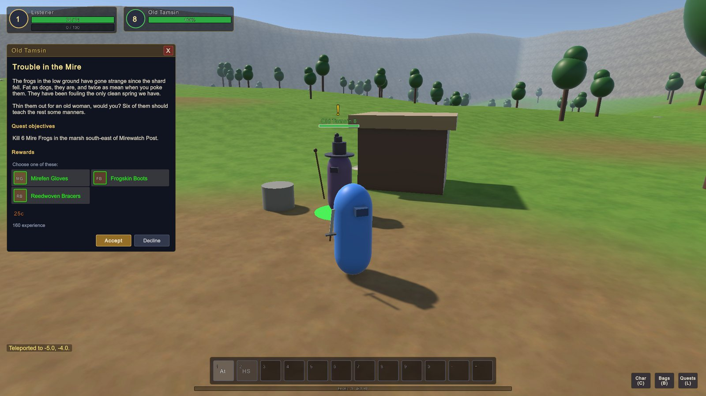

<sub><i>Phase 4: Old Tamsin at the Mirewatch Post offers a quest. Quests, items and loot are data; the server decides what is offered, what drops and what counts.</i></sub>

</div>

> [!NOTE]
> **This is an early-stage, work-in-progress project.** Madlands is a solo project with a big goal: a homemade MMORPG in the spirit of World of Warcraft, with tab-target combat, quests, dungeons and a shared world.
> What you see today is **the engine room**. All art is placeholder (capsules, boxes and lollipop trees; item icons are colored tiles). Real art arrives in Phase 5.
> Development is AI-assisted (Claude Code).

## What is Madlands?

Three hundred years ago the moon **Ysolde** cracked and rained shards across the continent of **Calderra**. Wherever the shards fell, the land twisted into what people now call *the Madlands*. The shards are also the source of all magic: some want to harvest their power, others want to seal them away forever. <sub>([lore draft](docs/gdd.md))</sub>

**The goal** is a small but real MMO, with the same kinds of systems as WoW and a much smaller world:

- Tab-target combat with cast times, cooldowns and auras
- Classes and races, quests, loot and gear
- Groups, guilds and dungeons
- A stylized low-poly world

**The approach:** the game is built **one playable phase at a time**. The architecture is designed for the finished game from day one, so nothing built early has to be thrown away later.

## 🗺️ Progress

| Phase | Scope | Status |
|:---:|---|:---:|
| 0 | Foundation: repo, tooling, architecture, decision log | ✅ Done |
| 1 | **Walking skeleton:** many players in one world, synced by the server | ✅ Done |
| 2 | **Accounts, login, characters, database** | ✅ Done |
| 3 | **Core combat:** targeting, spells, auras, creature AI, XP and levels | ✅ Done |
| 4 | **Items, loot, economy, quests** | ✅ Done |
| 5 | Vertical slice: the first real zone, with real art. *"Is it fun?"* | 🔜 Next |
| 6–7 | Social (chat, groups, guilds) and dungeons | ⬜ |
| 8–10 | Bigger world, talents, professions, PvP, launch | ⬜ |

Details: [docs/roadmap.md](docs/roadmap.md)

### Latest milestone: Phase 4 ✅

The **core loop** is in: take a quest, go out and fight, loot, get better gear, turn in, level up. The Mirewatch Post next to the spawn has a captain and an old herbalist with eight quests between them, and a quartermaster who buys and sells.

| What | How |
|---|---|
| Items | 45 items as data: weapons, armor, rings and trinkets, bags, food, drink, draughts, quest items and junk, in five qualities ([ADR 0010](docs/adr/0010-items-inventory-loot.md)) |
| Inventory | 20 equipment slots, a backpack and four bag slots. Gear raises your stats and sets your weapon swing; weapons and shields show in your hands |
| Loot | Loot tables per creature, rolled for whoever tapped it. Corpses sparkle for their owner; quest items only drop while you need them; a 3% chance of a green |
| Economy | Gold, silver and copper; a vendor who sells supplies and buys your junk; sell all junk with one click |
| Quests | 8 quests in a chain: kill, collect, talk and explore objectives, reward choices, "!" and "?" over NPCs, quest log (L) and tracker ([ADR 0011](docs/adr/0011-quests-and-npc-dialogs.md)) |
| UI | Bags (B), character sheet (C), item tooltips, loot, vendor and quest windows, drag and drop |
| Verified | 132 automated tests, including loot, vendors, all four quest objectives and relogging on a real server; 200 bots fighting and looting at 0.9–1.5 ms per tick |

<details>
<summary>Phase 3: core combat</summary>

| What | How |
|---|---|
| Classes | **Warrior** (rage, melee), **Shardmage** (mana, ranged, slows and roots), **Warden** (mana, heals and shields); 5–6 abilities each, learned from level 1 to 8 |
| Spells & auras | 19 spells as data: cast times, cooldowns, projectiles, area effects, damage and heals over time, slows, roots, stuns, absorbs, buffs ([ADR 0005](docs/adr/0005-spell-and-aura-model.md)) |
| Creatures | Frogs, a wolf pack, a walled bandit camp with casters, and training dummies. AI with aggro, threat, call for help, pathfinding (DotRecast navmesh) and evading |
| Rules | Server-side hit tables (miss, dodge, parry, crit), armor, line of sight, facing, range; levels 1–10 with classic experience rules |
| HUD | Unit frames, buffs and debuffs, cast bars, an action bar with cooldowns, nameplates, floating combat text, chat, tooltips |
| Tools | GM commands (`.level`, `.tele`, `.spawn`, `.god`, `.info` …); bots that hunt creatures for load tests |
| Verified | 200 bots hunting creatures at 0.8–1.1 ms per server tick, 0 movement corrections; 98 automated tests, including whole fights on a real server |

</details>

<details>
<summary>Phase 2: accounts and characters</summary>

| What | How |
|---|---|
| Accounts | Register and log in through an HTTP account API; Argon2id password hashes, hashed session tokens |
| Characters | Create, select, delete; up to 10 per account, realm-unique names; races and classes are data |
| Persistence | PostgreSQL with migrations; state saved write-behind (the game loop never waits for the database) |
| Client | Login, character select and create screens in UI Toolkit; the map scene is loaded by the id the server sends |

</details>

<details>
<summary>Phase 1 measurements</summary>

| Measurement | Result |
|---|---|
| Concurrent players in the test | 200 bots + 1 real client |
| Server tick (target < 5 ms) | **0.4–0.9 ms** average |
| Movement corrections by the server | **0** during the whole test |
| Local ping | ~15–30 ms |
| Client FPS with 200 visible players | 375–1100 |

</details>

## 📸 Progress gallery

<table>
  <tr>
    <td width="50%">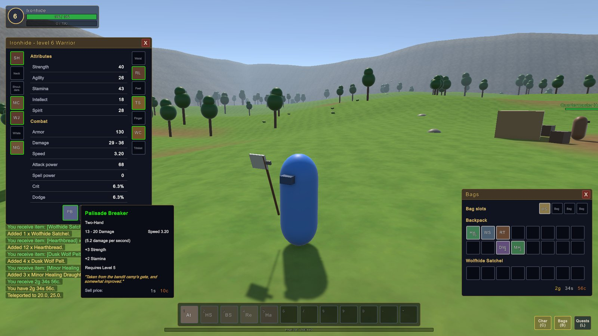</td>
    <td width="50%">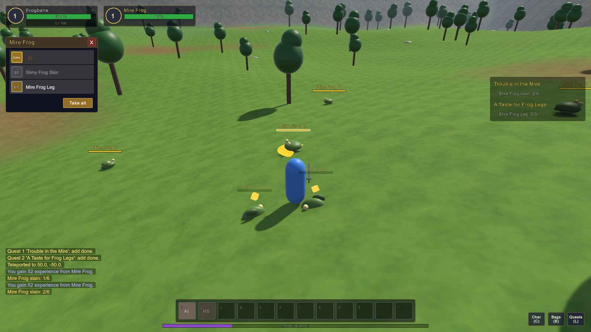</td>
  </tr>
  <tr>
    <td><sub><b>Phase 4 · Gear.</b> A level 6 Warrior in quest and drop rewards: the two-handed Palisade Breaker in hand, green armor on the character sheet, the old sword and tunic in the bags.</sub></td>
    <td><sub><b>Phase 4 · Loot.</b> Frogs drop copper, junk and, for players on the frog leg quest, frog legs. The tracker on the right counts the kills.</sub></td>
  </tr>
  <tr>
    <td width="50%">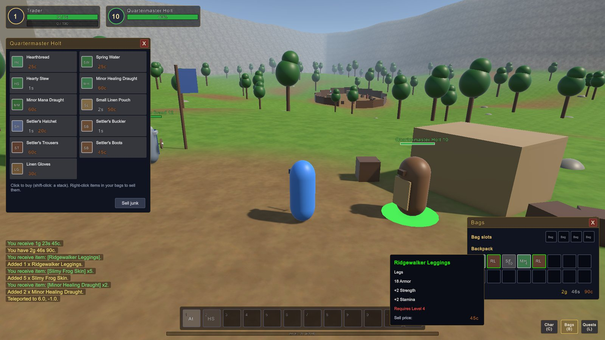</td>
    <td width="50%">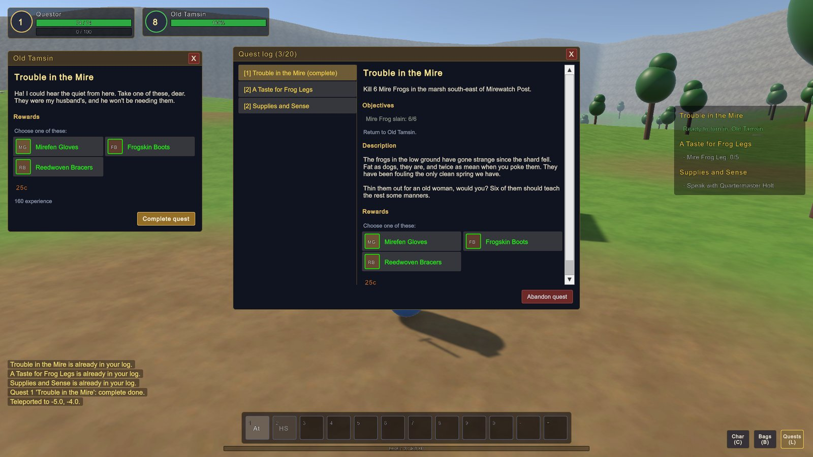</td>
  </tr>
  <tr>
    <td><sub><b>Phase 4 · The quartermaster.</b> Food, water, draughts, a bag and basic gear. Right-click items in your bags to sell them; tooltips show stats, requirements and prices.</sub></td>
    <td><sub><b>Phase 4 · Quest log.</b> Objectives, the story and the rewards; on the left, turning in a finished quest and picking one of three rewards.</sub></td>
  </tr>
  <tr>
    <td width="50%">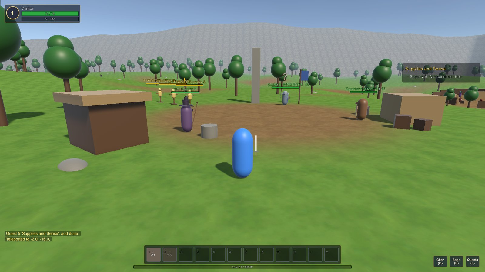</td>
    <td width="50%">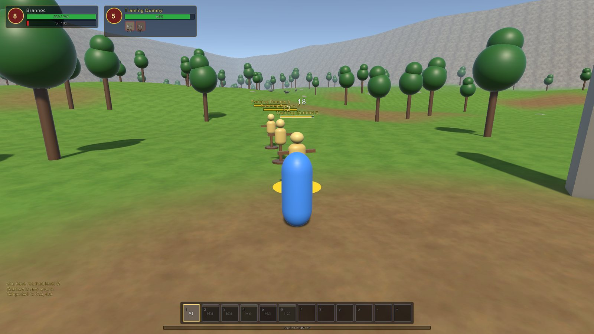</td>
  </tr>
  <tr>
    <td><sub><b>Phase 4 · Mirewatch Post.</b> The outpost at the spawn: Old Tamsin's hut, the captain's banner and the supply tent. A yellow "!" means a quest to take, a gray "?" one in progress.</sub></td>
    <td><sub><b>Phase 3 · The HUD.</b> A level 8 Warrior at the training dummies: Rend and Hamstring on the target, rage bar, damage numbers and the action bar with all six warrior abilities.</sub></td>
  </tr>
  <tr>
    <td width="50%">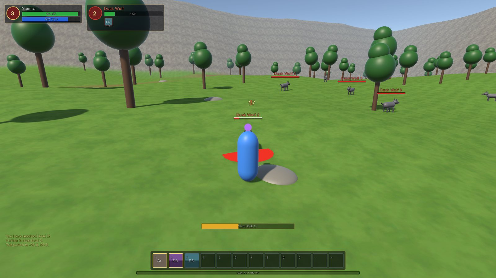</td>
    <td width="50%">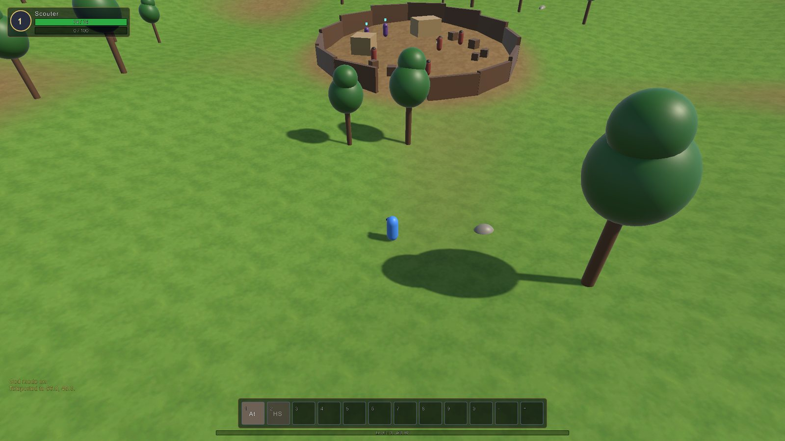</td>
  </tr>
  <tr>
    <td><sub><b>Phase 3 · Combat.</b> A Shardmage fights the Dusk Wolf pack. The server decides every hit; the client draws the cast bar, debuffs, nameplates and damage numbers.</sub></td>
    <td><sub><b>Phase 3 · The bandit camp.</b> Palisade, tents and crates are exported from Unity as collision geometry. The server builds its navmesh from it, so bandits path around walls, and spells need line of sight.</sub></td>
  </tr>
  <tr>
    <td width="50%">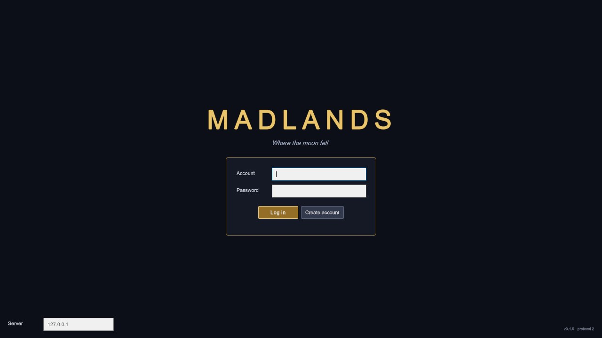</td>
    <td width="50%">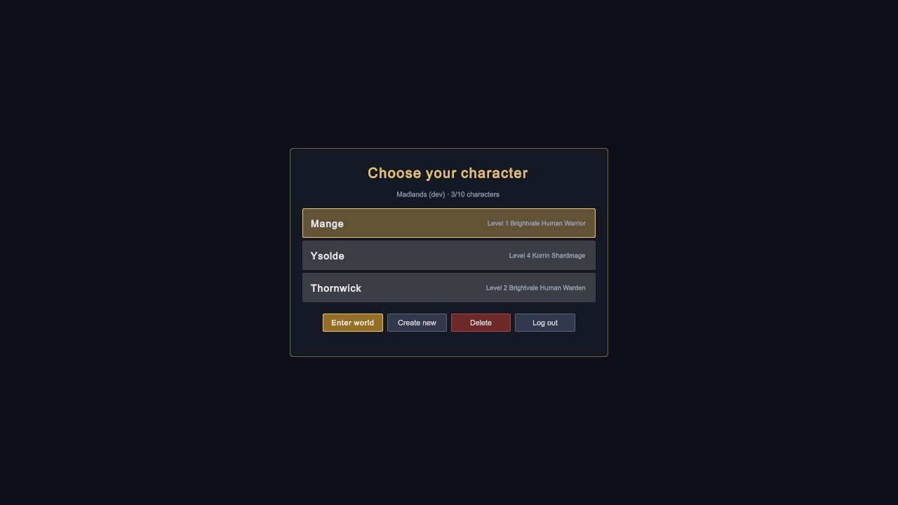</td>
  </tr>
  <tr>
    <td><sub><b>Phase 2 · Login.</b> Accounts with Argon2id-hashed passwords; the server field allows connecting to any realm.</sub></td>
    <td><sub><b>Phase 2 · Character select.</b> Characters live in PostgreSQL; race and class names come from the server's content files.</sub></td>
  </tr>
  <tr>
    <td width="50%">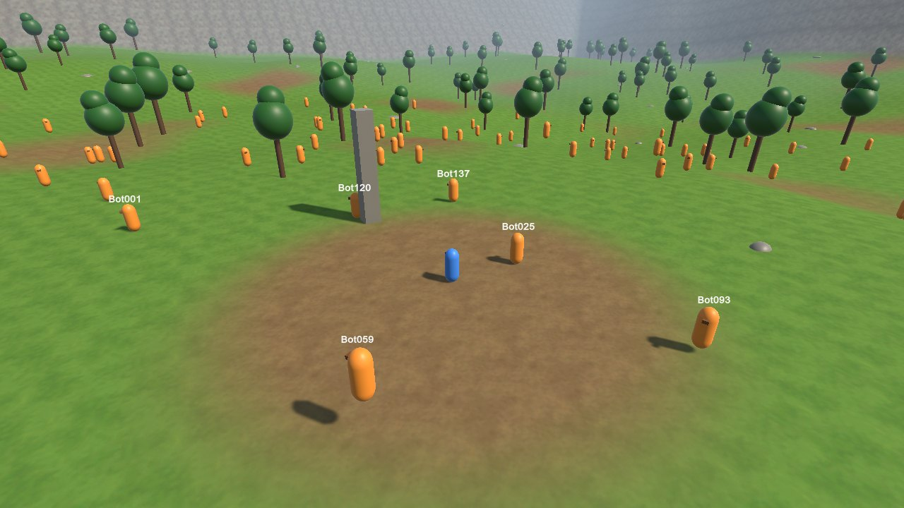</td>
    <td width="50%"></td>
  </tr>
  <tr>
    <td><sub><b>Phase 1 · 200 bots.</b> A real player (blue) and 200 bots (orange) sharing one world, kept in sync by the server.</sub></td>
    <td><sub><b>The "Testlands" test world.</b> 512 × 512 m of hills, forest and fog, generated entirely from code.</sub></td>
  </tr>
  <tr>
    <td>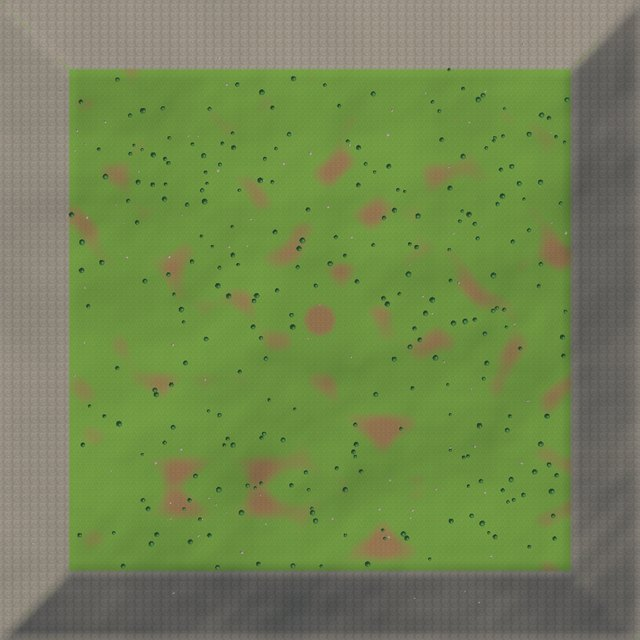</td>
    <td valign="top">
      <b>Dev log</b>
      <ul>
        <li><sub><b>2026-10-18 – Phase 4 done.</b> Items, inventory, loot, vendors and money; data-driven quests with NPC dialogs, a quest log and a tracker; the Mirewatch Post with eight quests. Bots loot too.</sub></li>
        <li><sub><b>2026-10-16 – Phase 3 done.</b> Combat: three classes, spells and auras as data, creature AI with navmesh pathfinding, experience and levels, a full HUD. Bots fight too.</sub></li>
        <li><sub><b>2026-10-16 – Phase 2 done.</b> Accounts, persistent characters, PostgreSQL, login and character screens, CI. Characters survive logout and server restarts.</sub></li>
        <li><sub><b>2026-10-16 – Phases 0 & 1 done.</b> Server, client, bots and tests are in place. 200 players run around without a single movement correction.</sub></li>
      </ul>
    </td>
  </tr>
</table>

## 🏗️ How it works

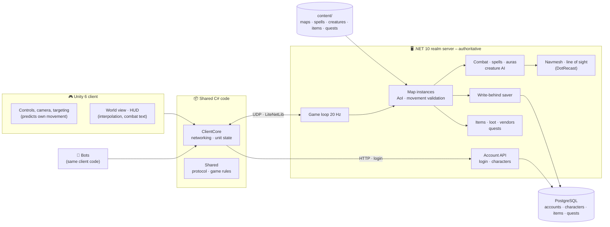

**Core principles**

- **The server is the authority.** The client moves its own character immediately so it feels responsive. The server checks every move and decides every hit, miss and heal.
- **The engine is replaceable.** All game logic lives in the server and in shared C# code that is not allowed to reference Unity. The client is "just" a view.
- **Content is data.** Maps, races, classes, spells, creatures, items, loot tables, quests and spawns are text files with stable IDs, validated automatically. The server sends the client what it needs to show them, so a new spell, item or quest needs no client rebuild.
- **Bots run the exact same client code as the game.** That makes it possible to load-test with hundreds of "players" on one machine.

More in [docs/architecture.md](docs/architecture.md) and the decision log in [docs/adr/](docs/adr/).

## 🧰 Tech stack

| Part | Choice |
|---|---|
| Client | Unity 6 (URP), Input System, UI Toolkit |
| Server | .NET 10, LiteNetLib (UDP), ASP.NET Core minimal API (account API), Serilog, DotRecast (navmesh) |
| Persistence | PostgreSQL, Npgsql + Dapper, DbUp migrations, Argon2id |
| Shared code | C# (netstandard2.1), compiled by both Unity and .NET |
| Testing | xUnit, headless bot clients, GitHub Actions CI with PostgreSQL |
| Coming up | Addressables, Localization |

## 🚀 Getting started

Requirements: [.NET 10 SDK](https://dotnet.microsoft.com/), Unity 6000.6.5f1 and Docker (for PostgreSQL).

```powershell
# 1. Start PostgreSQL (once; it keeps running in Docker)
docker compose -f deploy/docker-compose.yml up -d

# 2. Start the realm server: game on UDP 7777, account API on HTTP 7780 (local only).
#    --gm-all lets every account use GM commands (development only).
dotnet run --project server/Madlands.Server -c Release -- --bind 127.0.0.1 --gm-all
#    No Docker? Add --db memory (accounts and characters are lost when the server stops).
#    Give one account GM commands permanently instead: ... -- set-gm <account> 3

# 3. (optional) bots that register, log in and hunt creatures (lift the API rate limit for many bots)
#    server: ... --api-rate-limit 0
dotnet run --project server/Madlands.Bots -c Release -- --count 100        # --mode wander to just run around

# 4. Client: open client/ in Unity Hub and press Play (it always starts at the login screen),
#    or build an exe via Madlands > Build Windows Client. Create an account on the login screen, or
#    skip the screens in dev: -autoconnect logs in as the lowercased name, creating account and character.
builds/client/Madlands.exe -screen-fullscreen 0 -autoconnect -name Alice -class warrior
builds/client/Madlands.exe -screen-fullscreen 0 -autoconnect -name Bob -class shardmage
```

Run the tests with `dotnet test Madlands.slnx` (PostgreSQL tests are skipped if the database is not running).

### 🎮 Controls (WoW-style)

| Input | Action |
|---|---|
| W / S | Forward / backward (backpedaling is slower) |
| A / D | Turn (strafe while holding the right mouse button) |
| Q / E | Strafe left / right |
| Right mouse + drag | Steer the character and the camera |
| Left mouse + drag | Orbit the camera freely |
| Both mouse buttons | Run forward |
| Mouse wheel | Zoom |
| Space | Jump (no air control) |
| Num Lock / R | Autorun |
| Left click a unit | Target it |
| Right click a unit | Attack an enemy, talk to a friendly NPC, or loot a sparkling corpse (shift: take everything) |
| B / C / L | Bags / character sheet / quest log |
| Click an item | Pick it up; click a slot to put it down (or drag). Drop it outside the windows to destroy it |
| Right click an item | Use, equip or unequip it; sell it while a vendor is open |
| Tab | Cycle through enemies in front of you |
| 1–0, -, = | Action bar (hover a button for its tooltip) |
| Right click a buff | Cancel it |
| Enter | Chat. Lines starting with `.` are GM commands; `.help` lists them |
| Esc | Close chat, windows, clear the target, or open the menu |
| F3 | Toggle the debug overlay |

**Where to go in the test world:** the Mirewatch Post at the spawn has quests (Old Tamsin, Captain Edda Brand) and a vendor (Quartermaster Holt); training dummies stand next to it. Frogs (neutral) live south-east, the wolf pack (hostile) north-west and the walled bandit camp north-east. `.level 5`, `.tele 70 50` (outside the camp), `.additem <id or name>`, `.money <copper>` and `.quest add|complete|reset <id>` are handy shortcuts.

## 📁 Project structure

```
client/                     Unity 6 project (our code in Assets/Madlands)
shared/Madlands.Shared      Protocol and game rules, shared by server and client
shared/Madlands.ClientCore  Engine-free networking and unit state, used by the client and bots
server/Madlands.Server      The realm server: game loop, combat, AI, items, quests, account API, persistence
server/Madlands.Navigation  Navmesh (DotRecast) and line of sight
server/Madlands.Content     Loads and validates game data
server/Madlands.Bots        Bot players for load testing
content/                    Game data: maps, races, classes, factions, spells, creatures, levels, items, loot, quests
deploy/                     Docker Compose for PostgreSQL and Seq (logs)
tools/                      Tooling (ContentTool)
docs/                       Architecture, decision log (ADR), roadmap, game design
```

## 📚 Documentation

- [Roadmap & status](docs/roadmap.md)
- [Architecture](docs/architecture.md) and [decision log (ADR)](docs/adr/)
- [Game design & lore (draft)](docs/gdd.md)

## License

No license has been chosen yet, so all rights are reserved for now. Feel free to look around and get inspired.
Madlands is not affiliated with Blizzard Entertainment or World of Warcraft.
