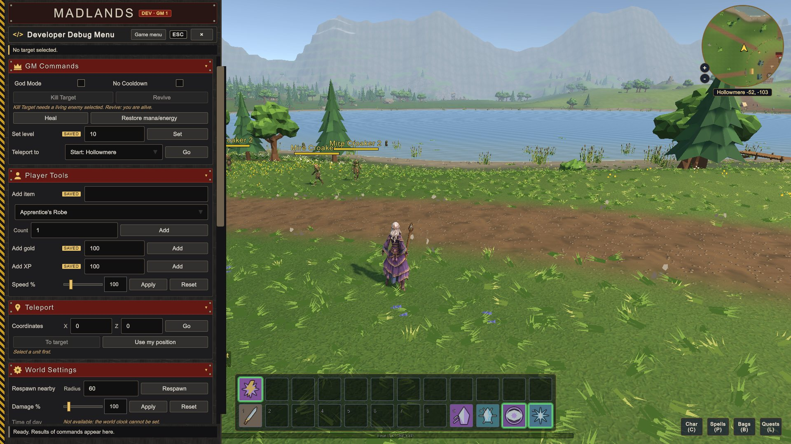
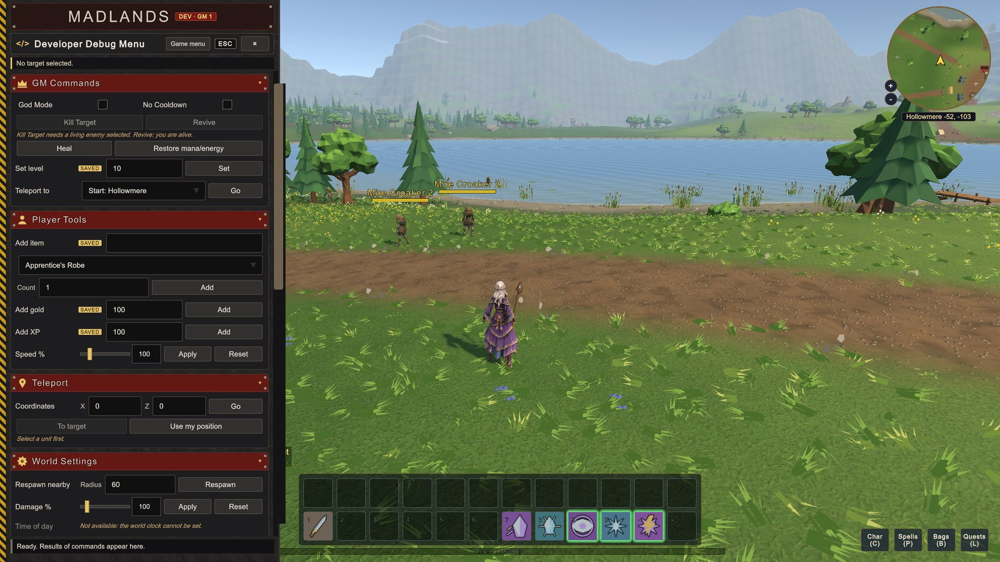
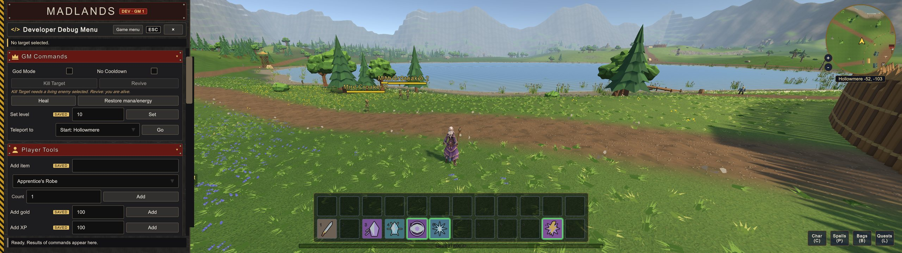
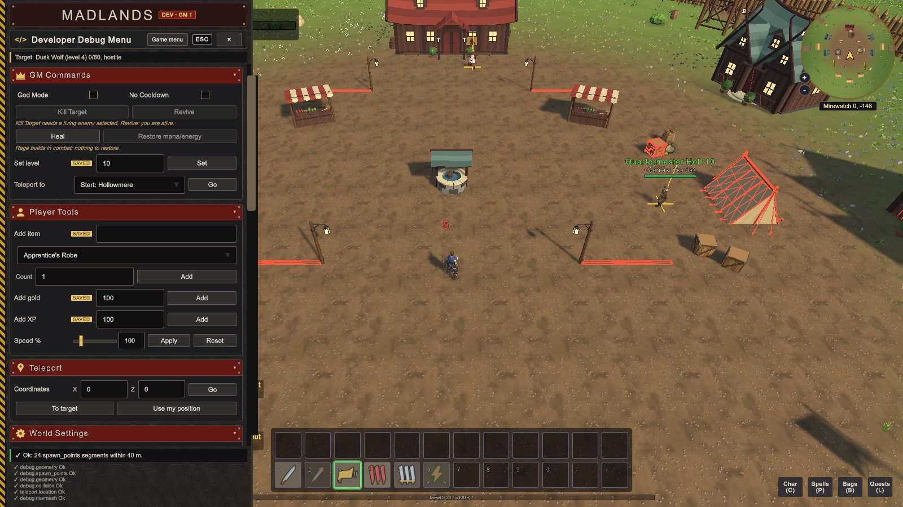
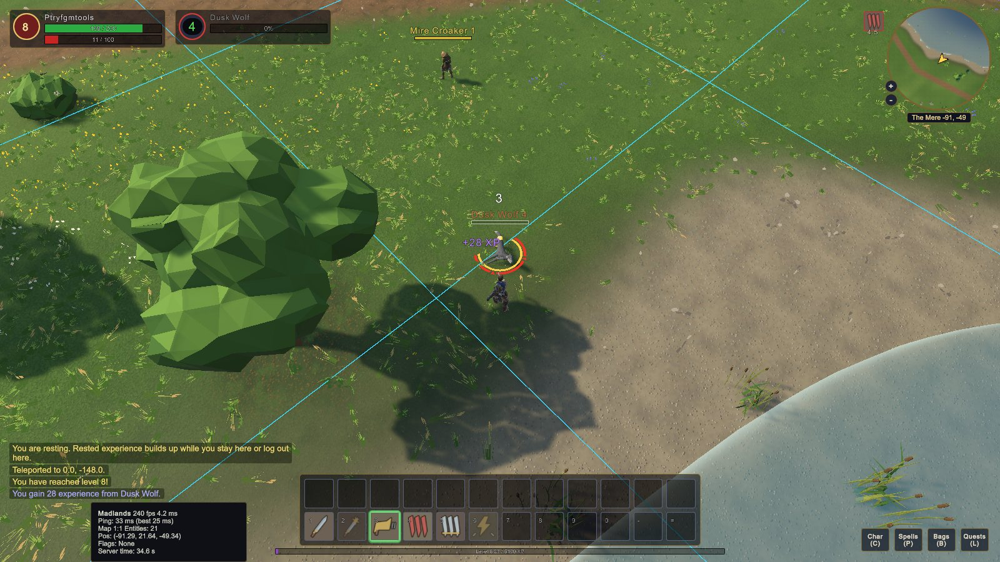

# Developer GM Menu

A left-docked developer and GM panel for Madlands sessions with GM rights, built from
`IMPLEMENTATION_PLAN.md` and `design-reference.png` (concept 3). `DISCOVERY.md` maps what the repository
already had and why each command is implemented or deferred. Everything the menu does goes through the same
server command service as automation, and the server decides.



## Enabling it

The menu appears only when the server says the session has GM rights. Clients cannot grant themselves anything:
the rights come from the account, never from the client.

- **Local development:** start the realm with `--gm-all` (every account is a GM), for example
  `dotnet run --project server/Madlands.Server -- --bind 127.0.0.1 --db memory --gm-all`.
- **A persistent realm:** `dotnet run --project server/Madlands.Server -- set-gm <account> 1`.
- In the world, **§** (the key left of 1; \` on US keyboards; rebindable in Settings > Keys as
  "Developer menu (GM)") opens and closes the menu. **Esc** also closes it, after what Esc closes today
  (the chat line, a held item, loot, the vendor, open windows), and otherwise keeps opening the normal game
  menu. The menu's **Game menu** button opens that too. In *Developer Tools* you can let Esc open the
  developer menu instead (Shift+Esc then opens the game menu); that choice is stored per machine.
  The plan asked for Esc; the owner chose a key of its own so that Esc keeps its usual meaning.
- `-open gm` on the client command line opens the menu as soon as GM rights arrive (screenshots).
- Without GM rights the key does nothing, Esc behaves exactly as before and the menu is never shown.

## Using it

The sections can be folded, and which ones are folded is remembered. Buttons that cannot run say why under
their row (no target, alive, no debug spawns...). The bottom of the panel shows the last result (code and
message) and a short history. Rows tagged **SAVED** change saved character state: level, experience, money,
items, quests and kills. Everything else is a temporary override that ends with the session and is never saved.

| Section | Controls |
|---|---|
| GM Commands | God Mode, No Cooldown (checkboxes bound to the server's state), Kill Target, Revive, Heal, Restore mana/energy, Set level, Teleport to a destination from the server |
| Player Tools | Add item (searchable, real item catalog) and count, Add gold, Add XP, Speed % (apply / reset) |
| Teleport | Coordinates (x, z) with Go; **Pick on map** opens the world map: a click sets X and Z (red mark), a double-click teleports there at once; "Use my position"; To target |
| World Settings | Respawn nearby (radius), Damage % (apply / reset); time of day, weather and time scale are shown as not available |
| Spawn Entities | Creatures / NPCs tabs over the server's creature list, count 1-10, Spawn; debug spawn count and Despawn |
| Quest Tools | Quest (searchable) with Start, Complete and Reset |
| Debugging | Show FPS / stats (the F3 panel), Performance details, Show collision, Show navmesh, Show spawn points, Inspect target |
| Developer Tools | Reset debug overrides, Despawn debug spawns, the Esc choice; world saves are shown as not available |

While the menu is open the world keeps running. Clicks on the panel never reach the world, and typing in its
fields does not move the character or fire the action bar. Its buttons cannot take keyboard focus, so Space
and Enter keep jumping and chatting. Esc while typing leaves the field; the next Esc closes the menu.

## Command reference

All commands need a GM account (GM level 1 or higher). Ids are stable. Arguments are key/value text and are
validated against `shared/Madlands.Shared/Game/GmCommands.cs` on both sides.

| Id | Arguments | Runs | Does |
|---|---|---|---|
| `player.god_mode` | `enabled` bool | server | No damage, creatures ignore you, no spell costs or cooldowns (the existing `.god`) |
| `player.no_cooldown` | `enabled` bool | server | Spells start no cooldowns; current ones are cleared. The global cooldown stays |
| `player.heal_full` | none | server | Full health, mana and energy (not while dead) |
| `player.restore_resources` | none | server | Mana or energy to full; rage is left alone |
| `player.revive` | none | server | Back to life where you lie (not while alive) |
| `combat.kill_target` | none | server | Kills the selected living enemy through the combat system (loot and experience as usual) |
| `player.set_level` | `level` 1..255, the realm's cap checked | server | Sets the level; experience starts over |
| `player.add_xp` | `amount` 1..1000000 | server | Experience through the normal path (levels up) |
| `player.add_gold` | `copper` 1..1000000000 | server | Money (the menu field takes gold) |
| `player.add_item` | `item` id, `count` 1..250 | server | Items through the bag rules; `PARTIAL` when the bags fill |
| `player.speed_multiplier` | `percent` 25..500 | server | Movement speed (100 = normal) |
| `combat.damage_multiplier` | `percent` 0..1000 | server | Your own damage (100 = normal) |
| `teleport.location` | `location` id from the catalog | server | `start`, `rest:<n>`, `npc:<creature id>`, `creature:<creature id>` |
| `teleport.coordinates` | `x`, `z` | server | Inside the map, on the ground, snapped onto the navmesh nearby |
| `teleport.target` | none | server | 2.5 m from the selected unit, facing it |
| `spawn.entity` | `creature` id, `count` 1..10 | server | Creatures in front of you, on the navmesh; at most 40 debug spawns per GM; they never respawn |
| `spawn.despawn_debug` | none | server | Removes only your debug spawns |
| `quest.start` / `quest.complete` / `quest.reset` | `quest` id | server | The quest log's own rules (the existing `.quest`) |
| `world.respawn` | `radius` 1..500 (60) | server | Respawns dead creatures, gathered objects and emptied chests nearby |
| `debug.inspect_target` | none | server | The target's level, health, power, reaction, flags, auras; for creatures the AI state, home, spawn and threat list |
| `debug.geometry` | `kind` collision/navmesh/spawn_points, `radius` 10..80 (40) | server | Sends overlay lines (used by the overlays below) |
| `dev.reset_overrides` | none | server | God mode, no cooldown, speed and damage back to normal |
| `debug.fps` | `enabled` bool | client | The F3 panel (now with frame time) |
| `debug.performance` | `enabled` bool | client | Worst frame of the last second, managed and Unity memory, units in view |
| `debug.collision` | `enabled` bool | client | Draws the server's obstacle triangles (collision.bin: what movement and line of sight use) within 40 m |
| `debug.navmesh` | `enabled` bool | client | Draws the server's navmesh polygons within 40 m |
| `debug.spawn_points` | `enabled` bool | client | Marks creature spawn points within 40 m |

Result codes: `Ok`, `Partial`, `Unauthorized`, `InvalidArgument`, `NotAvailable`, `NoTarget`,
`ExecutionFailed`, `UnknownCommand`, `Busy` (the same command still waits for its answer) and `Timeout` (no
answer in 5 s). Every result carries a message and structured fields (for example `added`, `level`, `ai`).

The chat console (`.god`, `.heal`, `.level`, `.revive`, `.spawn`, `.speed`, `.quest` ...) keeps its syntax
and texts but runs the same code, and its changes reach the menu's checkboxes.

## Architecture

```text
DeveloperMenu (UI) ──┐
PlaytestController ──┼─> GmCommandClient (ClientCore) ── GmCommand ──> GameServer ──> GmCommandService
                     │     validation, one request per                 rate limit       rights (default deny),
                     │     command, timeout, history,                                   schema validation,
                     │     client-side overlays                                         existing systems,
                     │                                                                  audit log
                     └<── GmCommandResult / GmStatus / GmCatalog / GmDebugGeometry <────┘
ChatHandler (.god, .heal ...) ─────────────────────────────────────────────> same helpers
```

- `shared/Madlands.Shared/Game/GmCommands.cs`: ids, categories, argument schema, result codes, parsing.
- `shared/Madlands.Shared/Net/GmMessages.cs`: five messages (protocol version bumped; roundtrip tests).
- `server/Madlands.Server/Commands/GmCommandService.cs`: the registry and handlers. Gameplay goes through
  `CombatSystem`, `SpellSystem`, `ItemSystem`, the quest log, `MapInstance.Teleport/SpawnCreature/RemoveEntity`
  and the navmesh. Every call is logged with command id, sanitized arguments, player, account, GM level and
  result code; refusals are warnings.
- `shared/Madlands.ClientCore/GmCommandClient.cs`: the one client entry point (`GameClient.Gm`).
- `client/Assets/Madlands/Scripts/UI/DeveloperMenu.cs`, `DeveloperMenuArt.cs` (icons and textures drawn in
  code), `Resources/DeveloperMenu.uss`, `Scripts/World/DebugGeometryView.cs` (overlay lines).
- Debug spawns are tracked per GM and removed when the GM leaves the world. Overrides live on the server's
  `Player` object only and are never saved.

## Automation (AI Critic)

The Playtest Controller (playtest builds only) has a `gm_command` action that calls `GameClient.Gm.Execute`.
That is the menu's own path, so a scenario step and a menu click give the same result. It writes the
structured result into the observation (`gm_result`) and the GM state into every observation (`gm`). It also
writes `gm_commands.json` (every command with its schema, for discovery) and `gm_catalog.json` (creature and
destination ids) into the mailbox. `open_developer_menu` opens the panel for a picture.

`press_key` presses Esc or § through the Input System for checks of the key handling;
`developer_pick_on_map` presses the menu's Pick on map button and `click_map` clicks the world map with the
Input System mouse where a given world x, z is drawn (`double = true` for a double-click). Observations
report the menu's X/Z fields (`developer_coordinates`) and whether the map is picking (`map_picking`).
`gm_command` is for scenario scripts only: the Codex explorer cannot choose it, and the explore critic is told
that a scenario marked CHEATS ENABLED used GM commands as setup, so an OK answer is not gameplay evidence.
The sample workflow is `tools/AICritic/scenarios/gm_tools.toml` (always scripted):

```powershell
python tools/AICritic/aicritic.py explore gm_tools --no-review          # the commands only, no Codex call
python tools/AICritic/aicritic.py explore gm_tools combat --mode scripted # cheats scenario next to a normal one
```

It teleports to the Mire Croakers' first spawn (`creature:1`), sets level 5 and god mode, spawns a Dusk Wolf
(creature 2) as a debug spawn, inspects it, fights it, shows the navmesh, opens the menu for a picture,
despawns, resets the overrides and finally sends an unknown command to show a structured failure.

## Security

- Every command is authorized on the server against the session's GM level, whatever sends it. A client
  without rights gets `Unauthorized` even for a hand-made packet; that is covered by a test.
- There is no new network endpoint: the commands travel on the existing game connection, behind the same rate
  limit as GM chat commands. Nothing executes arbitrary code or shell commands.
- The client build still contains the menu code. It stays hidden and does nothing unless the server grants
  GM rights, so the server is the boundary, as it already is for the `.` console.
- Overrides are not saved and debug spawns leave with their GM. Awarded items, levels, money, quest changes
  and kills are real, and the menu tags them **SAVED**.

## Deferred

Not built, because the systems they need do not exist (see `DISCOVERY.md`): time of day and weather (no
settable world clock, no weather), time scale and world pause (a shared realm is never paused), fly mode
(no flying movement), AI path display, debug save slots, save/load/reset world, verbose log switches, learn
skills and reset talents (spells come from class and level; there are no talents). The menu shows these rows
as unavailable, with the reason. The reference image's Objects and Props spawn tabs are left out: only
creatures can be spawned.

## Verification

Run on 2026-11-27 on the committed tree plus only this feature, built in its own worktree (other agents'
uncommitted work excluded).

- `dotnet test Madlands.slnx`: 197 of 197 pass, among them 12 new realm tests (`GmCommandIntegrationTests`:
  refusal without rights, also for a hand-made packet; god mode on and off; level, XP, gold, revive and heal
  rules; bag limits and `Partial`; debug spawn cap, tracking and cleanup when the GM leaves; kill and inspect
  targets; catalog teleports and map bounds; overrides and their reset; overlay geometry; client-side
  commands and `Busy`; quest start/complete/reset) and the roundtrips of the five new messages.
  Windows' socket failures (WSAENOBUFS) sometimes broke one or two network tests in a run; they passed on a
  rerun.
- `python -m unittest discover -s tools/AICritic/tests`: 48 tests pass, including the `gm_command` rules
  (script only, never the explorer).
- Unity: the normal client (`BuildTools.BuildWindowsFromCommandLine`) and the playtest client both build
  without warnings in the new files.
- `aicritic.py explore gm_tools --no-review` (real realm, real playtest client): all 32 scripted steps did what
  they should (the last one fails on purpose):
  - teleport to `creature:1`, level 8, god mode on, a debug Dusk Wolf spawned and inspected (`ai=Idle`);
  - god mode off: the wolf noticed the player at once and attacked; `teleport.target`, then a real fight that
    killed it (`ai=Dead`);
  - the navmesh, collision and spawn point overlays drawn; the menu opened by automation showed the server's
    state and the automation's own commands in its history;
  - one debug spawn removed, the overrides reset, and an unknown command answered with `UnknownCommand`.
- Keys, with real key presses through the Input System: Esc opens and closes the game menu as before; §
  opens the developer menu and § or Esc closes it; with the bags open the first Esc closes the bags and the
  second opens the game menu. No text focus was left behind.
- Pick on map, with real mouse clicks through the Input System: a click at world (40, -120) filled the fields
  with exactly `40.0, -120.0` and left the player where it was; a double-click at (-55, -97) filled them and
  teleported the player there.
- Without GM rights (a realm without `--gm-all`): Esc opens the game menu as before, the menu cannot open,
  `gm_command` answers `Unauthorized` and `.level` in chat is refused.

| | |
|---|---|
|  |  |
| 2560x1440 | 32:9 ultrawide, 5120x1440 (the panel stops at its maximum width) |
|  |  |
| Collision (red) and spawn points (yellow) in Mirewatch, menu opened by automation | The server's navmesh after the scripted fight |

Not verified by a person yet: how the menu feels with a mouse (dropdown popups, slider dragging, typing in
the search fields), and other UI scales than 1.0.
